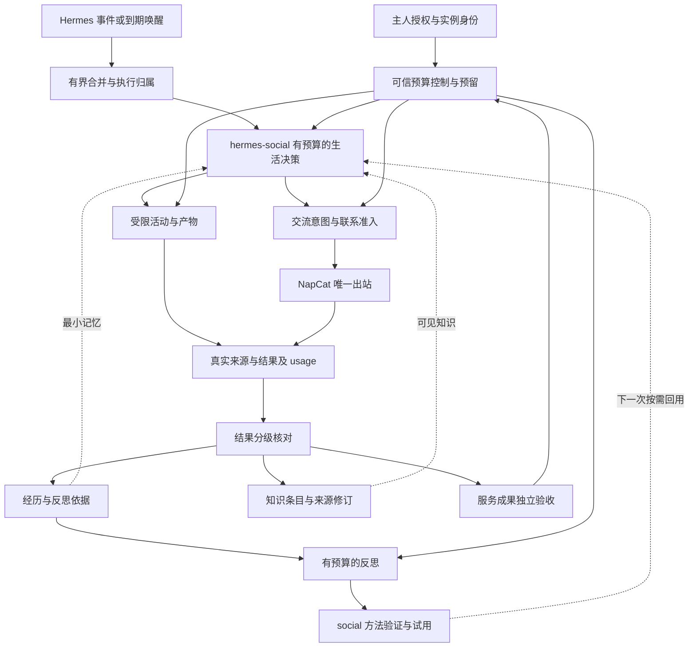
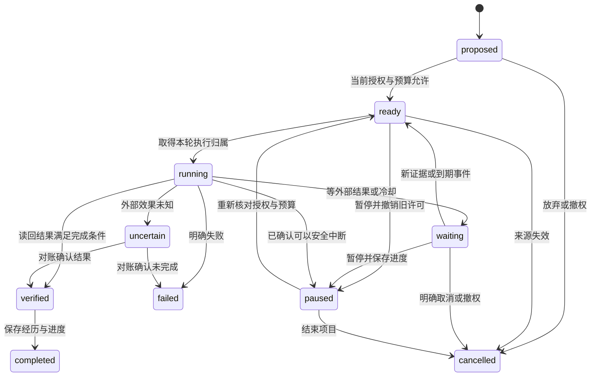

# 互联网生活能力开发方案

初稿：2026-10-31；本次修订：2026-11-01。目标是让任意实例在授权范围内持续阅读、探索、创作、参与交流、积累经历，并让经历影响之后的选择。Hermes Companion 不预设角色身份、性格、兴趣或关系。初始自我描述属于实例；之后如何形成或修订认识，应由经历与反思来支撑。

2026-11-01 续接：连续话题、公开阅读、有来源分享、普通好友私聊与有限反馈策略试用已实现并部署，具体范围和分层验收见[本阶段记录](连续社交阅读与反馈实现.md)。下文保留主线方案及当时差距；当前有限试用不等于通用长期学习、自我模型修订或任意创作活动均已交付。

本文区分当前基线与后续提案。本次只完善开发文档，不修改功能代码、安装副本或运行配置，不启用自主研究、采集、额外调用或预算。本地安装情况以有日期的验收记录为依据，不将文档描述当作本轮重新验收。

既有 M1 人物与交流记忆、M2 共同经历及约定的实现分别见[人物记忆首个切片](人物记忆首个切片.md)、[纯本地记忆与交流续接](纯本地记忆与交流续接.md)及[共同经历、约定与联系反馈](共同经历约定与联系反馈.md)。它们保留历史编号，不代表完整长期学习已经交付。论文、固定版本代码与采用取舍见[研究与代码参考](研究与代码参考.md)；[本地 Hermes 能力核对](本地Hermes能力核对.md)是历史快照。

## 整体评审结论与闭环入口

四条主线可以组成完整循环，但需要先补齐共用的执行与证据合同，不能分别做成互不相连的聊天、笔记和预算功能。本文按下列顺序组织实际能力：

1. 主人授予实例身份、活动／来源／联系范围和初始研究额度；可信事件或一次性启动事件产生决策机会。
2. 确定性地合并变化、核对当前状态；按用途取得最小记忆／知识，并在模型调用前预留决策成本。
3. 实例提出兴趣、项目下一步或交流意图，服务校验并保存有限行动；允许继续、等待、暂停或结束。
4. 在执行前分别核对资源、来源、工具与联系许可，执行读取、研究、询问或汇报，保存真实结果和未知状态。
5. 将经历、知识修订、产物及实际 usage 按关联 ID 可靠交接；验证结果，不能把回答已生成或已送达记为任务完成。
6. 根据新证据形成反思和方法候选，在自然出现的新任务中验证与试用，再让有效方法影响后续选择；反例使其修订或撤销。
7. 服务成果另行经过主人／受信验证器验收，才可按授权规则追加研究额度。该支线不能成为初次研究的前置条件，也不要求朋友回应才能维持研究。

| 本轮评审发现的断点 | 统一后的处理 |
| --- | --- |
| 项目尚未选定，决策调用却已经需要费用 | 先用实例级研究决策额度预留，选定后关联项目，不先调用再补账 |
| 方法、反思和知识都有“保存方法”的描述 | social 管方法候选／验证／试用的权威状态；life-memory 管经历、反思、能力证据；知识服务只登记知识与版本引用 |
| 主人工作进度与公共活动缺少隔离交接 | 私人任务在原执行域运行，只经可信任务事件提供获准的进度；不能让公共生活回合读取私人 agent |
| 工作汇报受空闲及未回应闲聊阻塞 | 任务通知使用预授权用途和预留联系容量，可选交往继续退让，二者仍受总额与暂停约束 |
| N1 承担过多基础工作，N2 又一次要求全部闭环 | 拆为可独立验收的 N1a–N1c、N2a–N2d；统一采用文末路线作为开发顺序 |
| 删除和恢复主要写成各库自己的保证 | 以来源修订、策略与撤销版本贯穿事件交接；交接未确认或版本不明时不注入、不发送 |
| 旧基线漏掉已新增的明确记忆和方法切片 | 下文更新源码能力表；复用现有入口，不把源码存在写成真实运行验收 |

启动最小条件为：稳定实例与执行域、至少一个获准来源／任务、可信预算授予、可持久化状态及不依赖模型余额的停止入口。兴趣可以为空，由首次有界决策在允许来源中提出；没有来源或额度时说明缺口并等待，不虚构兴趣或活动。普通问答、人物记忆和公开研究分别启用，不能为了满足启动条件打开全部采集或切换私人 provider。

闭环完成与上线验收分开：开发阶段先以合成来源和捕获端验证同一因果链，真实模型验证语义，正式安装和真人场景再验证运行效果。本轮只修订路线与合同，没有运行新增循环。

## 论文依据与真实人机场景

本方案依据 [Generative Agents v2，第 4 节](https://arxiv.org/html/2304.03442v2)与 [Agentopia v1，第 3、4 节](https://arxiv.org/html/2606.07513v1)，借鉴其认知与活动机制。下表中的工程选择是本项目提案，论文实验不证明它们在真实 QQ 或其他人类场景中的效果。

| 论文机制 | 采用方式 | 场景调整 |
| --- | --- | --- |
| Generative Agents：观察、检索、反思、计划；检索综合相关性、时效和重要性 | 让有来源的经历及反思进入后续决策，按任务检索最小资料 | 先过滤可见范围，再排序；不要求为每条记忆增加模型评分或 embedding 调用 |
| Generative Agents：由经历形成带证据引用的反思，再分解与调整计划 | 保存反思依赖，并在新情境中检验方法 | 原始事实、推断、计划与已完成结果分别存储；反思可被反证和撤销 |
| Agentopia：Plan、Contact、Activity、Review 循环及自主记忆管理 | 将计划、交流、活动和复盘连接成可恢复过程 | 使用真实事件和到期唤醒；不同活动可异步推进，不照搬模拟周或所有参与者同步行动 |
| Agentopia：生活奖励与经验轨迹训练 | 借鉴长期结果评估，分别观察服务价值、学习进步和资源成本 | 第一阶段采用固定模型的经验适应；模型参数训练另立项目 |

Agentopia 的活动结果与反馈来自模拟环境和其他模型；论文的[局限章节](https://arxiv.org/html/2606.07513v1)明确说明了与人类社会的差距。当前项目直接与人接触：关系来自真实交流、约定与对方选择，网页和执行结果由实际回执核对，不能由环境模型编造。自己的关系印象允许单向存在，但不能确认为对方承认的友谊、信任或联系许可。

奖励取舍也要单独验证。[Agentopia 第 5.3 节](https://arxiv.org/html/2606.07513v1)报告，在其特定训练实验中，部分社会与经济指标改善，技能进步指标却下降 29.6%。本项目因此分别评估贡献、学习与成本，不以 token 增长、好感、发言次数或单一总分作为生活目标。上述实验结果不能直接推广为真实用户场景的效果。

## 运行层定位与自我模型

`hermes-social` 应定位为互联网生活运行层，社交只是一个活动适配器。当前保留插件 ID、配置命名空间和存储路径，避免名称迁移与行为变更混在一起；通用活动执行器仍待开发。目标分工如下：

| 层 | 职责 | 可发展的内容 |
| --- | --- | --- |
| 互联网生活运行层 | 观察机会、检索经历、提出选项、选择行动或等待、核对结果并安排复盘 | 关注事项、计划、选择理由和已验证方法 |
| 活动能力 | 交流、阅读、探索、创作等具体行动；返回真实回执 | 能力使用经验；每种活动仍须明确接入 |
| life-memory | 保存自身经历、他人印象、反思、能力证据、进度引用及自我修订；初期组合知识服务 | 记录方法依据与使用经历，活动／方法控制状态仍由 social 管理 |
| scoped-memory | 本地检索、来源依赖、可见范围、修订与删除；扩展 SQLite／FTS5 数据基础 | 支撑回用，不能因召回而改变权限 |
| 通道／宿主 | 验证真实来源、工具权限、收件人、预算与生命周期 | 只能由受信任配置改变的执行边界 |

固定内容仅保留任务协议、输出结构和真实执行边界。角色、语气、好恶、关系判断和行为经验不得写成框架常量，也不由呼唤名推定。`public_self` 是可选的初始公开资料，不读取私人 SOUL；它不是已经实现的自我发展机制。

后续应增加独立的本地自我模型版本：`instance_id`、`revision`、`description`、`interests`、`communication_preferences`、`evidence_refs`、`visibility`、`supersedes` 与状态。将初始自述、临时假设及验证过的经验分开；不把某个群友说“你就是……”直接提升为身份事实，也不把一次表扬永久固化为性格。

修订走“经历与结果→反思候选→小范围试用→后续证据→保留／修订／撤销”。模型可在已有预算的正常回合提出候选，存储层校验来源、实例和范围；公共场所只读取允许公开且依赖仍有效的部分。冲突、过期、撤回和反例应使修订重新评估，旧版本可追溯。框架不替实例预填人格，也不把经验当作允许任意修改权限或源码的指令。

验收不能只查提示词有没有变化：至少用两个不同初始身份运行同一框架；让一次有证据的失败形成方法候选，再在未写特判的新情境中观察选择变化；撤回来源后不再使用依赖该来源的结论；重启能恢复，其他实例、群及私人材料不串入。当前公共自述入口和固定参数试用已实现，自我模型版本与通用经验反思仍待开发。

N2a–N2d 合起来构成首个完整生活循环，必须覆盖以下环节，不再等全部通信功能完成后才加入反思：

1. 在已授权场所记录有来源的观察、实际动作及结果，分清对方发言、已确认事实、自己的推断和角色故事。
2. 为一次有预算的决策提供当前公开情境、相关经历、自己的关注事项及未完成计划；由模型选择回应、等待、继续活动或暂不行动。路由只管理身份、场所、明确控制和资源边界，不用措辞列表推断人际意图。
3. 对有反馈或重要的经历形成带证据的反思候选，记录下次可尝试的做法；观察到回复不自动等于关系改善，沉默也不自动等于拒绝。
4. 在后续相似但未写入特判的情境中召回该经验，实际改变选择；保存效果与反例，允许修订和撤销。

人物事实的核对机制继续保留；自己的临时印象与行为经验单列，不能当成对方承认的事实或双向友谊。角色的稳定价值与逐步形成的兴趣、经历、表达习惯分层管理，不能用每轮自报“成长”替代后续行为证据。

`hermes-life-memory` 和 `scoped-memory` 的存储、检索、证据与删除继续使用本地实现，通过版本化本地端口提供服务，不新增云记忆依赖。反思内容由 Hermes 在正常决策或有预算的复盘回合中提出，调用成本显式计入，记忆组件负责验证、持久化与召回。若要求语义推理也完全离线，则另需本地模型；零模型参与的存储组件本身不产生语义反思。

本项目先验证不改模型参数的经验适应。底层模型能力训练须有可训练模型、轨迹数据和独立评测，不能将调用固定模型并更新本地笔记称为权重学习。模拟世界的环境反馈也不能充当真实网页读取、真实社交互动或实际执行结果。

## 自主兴趣、长期目标与持续学习

### 兴趣从经历中形成

主人设定助手职责、允许的活动／数据／工具范围和预算，实例在其中自主提出兴趣、选择项目与调整方法。允许范围内的选题和普通研究步骤不要求逐次确认；超出既有预算、来源策略或外部行动范围时再按实际授权处理。初始兴趣可以由用户提供，也可以留空。

首个切片沿用当前精确 URL 来源；后续若接入公开搜索，可在主人批准的来源策略内自主发现、核验与选择新资料，无需逐篇询问。来源策略的接入另行验收，当前精确 URL 配置不能自动解释成任意网站访问许可。

兴趣候选来自实际阅读中的未解问题、反复出现的任务困难、一次创作尝试或持续关注的公开主题。保存形成理由、证据、已尝试活动、投入及后续选择，经历“候选→探索→持续关注／休眠／放弃”的修订。状态由活动证据支持，允许一次有价值的探索结束后不再继续，不强迫每个候选发展为长期兴趣。

“自己的兴趣”在这里指系统持续选择的方向，不以自述具有主观感受作为证明。稳定角色价值、逐步形成的兴趣、方法经验与对他人的事实分别管理；主人委托的任务也不自动改写为实例自发的愿望。闲暇研究可暂时没有服务收益，由独立的研究额度支持。

### 长期目标落为有限里程碑

长期目标是跨活动推进、可以调整或结束的项目。一个兴趣可产生多个项目，一个项目也可服务多个兴趣；长期目标不能直接变成无限执行的单会话 goal。模型选择项目时比较当前义务、问题价值、已有进展、资源与下一步可行性，允许等待和放弃。

| 记录 | 必须明确的内容 |
| --- | --- |
| 兴趣 | 主题、来源、形成理由、修订、当前状态和可见范围 |
| 项目 | 关联兴趣／委托、要解决的问题、预期产物、成功标准、非目标与授权版本 |
| 里程碑 | 本阶段可完成的成果、截止或复查时间、验证方式、时间／调用／费用上限 |
| 活动 | 当前输入、下一步、执行归属、实际进度、产物引用及完成／失败证据 |
| 调整 | 新证据、阻塞、预算变化、暂停／放弃理由及后续安排 |

例如，“提高公开资料研究能力”可分解为“比较两篇指定论文”“形成可核对的对照笔记”“在新主题复用方法”三个里程碑。项目保持同一 ID；下一次唤醒优先续接已有进度，防止重复阅读、重复生成产物或每天重新立项。来源失效、结果价值不足和研究预算耗尽都可以成为暂停或结束理由。

### 学习要在后续行动中体现

持续学习采用“问题→查证／实践→成果→验证→反思→新情境回用”的循环。经历至少记录输入、所选方法、真实结果、成本、错误和未解决问题。反思提出结论、依据、适用条件、可能的反例以及下一次如何检验；一次模型总结只进入候选，不自动成为已掌握技能。

| 能力变化 | 可以交付的成果 | 验证要求 |
| --- | --- | --- |
| 知识与判断 | 带来源的笔记、冲突分析、问题清单 | 核对来源支持范围，区分作者主张、已核事实与自身推断 |
| 方法与流程 | 可复用步骤、检查方法、Skill 候选 | 在未用于总结方法的新任务上复用，比较正确性、返工和代价 |
| 工具使用与创作 | 在获准工作目录生成的工具、实验记录或作品版本 | 按预设断言、实际运行或人工标准验收；功能代码生成与执行需对应授权 |
| 长期选择 | 改变选题、检索、计划或停止策略 | 给出经历依赖，并用后续结果检验；保留失败案例和撤销记录 |

能力档案保存任务类别、方法版本、验证样本、已知局限和最近复验时间，不凭空增加“技能等级”。知识被存储、工具被生成、测试通过、用户采用及跨任务迁移是不同结果。模型参数训练、自动修改核心代码和自动安装生成的 Skill 均不纳入首个切片。

### 成果有独立的完成证据

产物登记至少绑定项目／里程碑、版本或哈希、来源、可见范围、验证状态与成本引用。内容本身保存在获准位置；登记表不复制私人资料。来源修订后标记需要复核，验证失败保留原因，不能覆盖成成功。

验收标准在活动开始前确定：笔记核对关键陈述与出处，工具核对实际行为，创作按事先约定的要求评价，服务任务按用户确认或受信验证器判定。模型自评可供解释，不能单独产生成功、服务贡献或新增预算。不同用途的成果分别验证，实际发布另需相应出站授权。

## 本地知识库：SQLite＋FTS5 优先

知识库负责将获准聊天、公开资料和自主学习产物整理为可复用的知识，让实例能够理解讨论过的术语、找到来源、比较观点并继续研究。首版优先复用现有 SQLite 数据基础，增加知识条目、来源／修订和 FTS5 全文索引；向量检索作为可关闭的增强。此节是接入提案，当前源码不因已有 SQLite 与混合检索而自动具备完整知识库。

### 知识与经历记忆各自保存什么

| 场景 | 经历记忆 | 知识库 |
| --- | --- | --- |
| 群里聊到一个热梗 | 和谁、何时、在哪个场所讨论，自己怎样回应 | 含义、别名、用法、语气、出处与本群解释；不将局部用法推广为全网定义 |
| 当下话题或新闻 | 各参与者实际说过什么、哪些问题尚未解决 | 带时间的资料、时间线、不同主张、待核实信息与复查期限 |
| 专业知识讨论 | 问题如何提出、尝试过什么、结果如何 | 概念、方法、版本／环境、示例、限制及验证证据 |
| 自主兴趣学习 | 为什么研究、投入与进展、方法成败及能力变化 | 阅读笔记、可复用知识、问题关联、实验结果和作品引用 |

两者共享来源 ID、可见范围与依赖，提供不同的逻辑视图，不要求复制两份原始对话。经历回答“发生过什么、怎样影响自己”，知识回答“是什么、依据是什么、在什么条件下适用”。知识中的观点、自己的反思和关于他人的已确认事实分别标记，不能因写入知识库自动变成事实或人物档案。

### 轻量存储与最小记录

正文／来源与状态以受控 SQLite 数据层为准，FTS5 是可以重建的派生索引。优先新增知识领域表和版本化公共入口，不强行将知识全部塞进当前 `memories` 的短事实结构，也不直接操作其他组件私有表。现有 Store 的来源、事务、依赖和删除原则可复用，但完整知识 API 仍需实现和验收。

| 记录（提案） | 必须保存的内容 |
| --- | --- |
| 知识条目与修订 | 稳定 ID、标题、类型、正文、别名／标签、修订关系、状态、创建／修改时间 |
| 来源与主张 | 来源 ID／修订、消息或公开 URL／产物引用、作者或陈述者、读取时间、证据片段及哈希；区分主张与验证结果 |
| 内容块 | 所属条目／修订、段落或章节位置、原文、索引文本、来源坐标；不能脱离上下文单独确权 |
| 范围与时效 | 实例、来源场所、读取／输出用途、可见范围、知识适用版本、有效／复查时间及保留策略 |
| 验证与依赖 | 候选／转述／已验证／待复核／已替代／已撤回等状态，核对依据、依赖来源与撤销版本 |

小型热梗条目无需机械分块；长资料按段落／章节组织，保留代码、表格和引用上下文。原文件或作品保存在获准产物位置，由哈希和引用关联，不把任意主机路径交给模型。标题与别名优先匹配，正文用于补充；查询返回有界片段、出处、状态和适用条件，不将整库注入聊天。

SQLite／FTS5 的全文匹配、BM25 排序和命中片段能力见 [SQLite 官方文档](https://www.sqlite.org/fts5.html)。是否可用以实际 Hermes 解释器及 worker 为准；开发机能建 FTS 表不证明目标宿主支持。缺少 FTS5 时报告能力缺口，可明确降级到既有关键词路径，不谎报全文索引成功，也不擅自更换活动环境的 SQLite。

### 中文、缩写与热梗检索

默认 `unicode61` 按连续字符形成词，不自动解决中文分词；`trigram` 的全文查询不能匹配少于三个 Unicode 字符的字符串，见 [FTS5 分词器说明](https://www.sqlite.org/fts5.html)。因此首版不能只打开默认 FTS5 就宣称中文检索完成。

首版在应用层生成可复现的中文词项／相邻双字，结合英文词、缩写、别名、标签与原文精确匹配；FTS 索引与查询使用同一版本的预处理。沿用现有双字机制时须补足长资料分块及覆盖，不照搬短记忆的词项数量上限。后续可评估专用中文分词器，不能用未经验证的字典替换掩盖热梗召回问题。

原文、标点、大小写、emoji 和来源坐标保留；用于检索的规范化文本另存。网络缩写、谐音和别名是带出处、语境与修订的候选，不自动建立跨群全局同义词；相同词在不同群或时间可有不同含义。用户查询转成受限、转义的 FTS 表达式，不能直接拼接成任意 SQL 或不受控 MATCH 语法。

单字、纯 emoji 或标点构成的梗另走受控别名／作用域内原文精确匹配，限制扫描预算并报告检索路径，不能将分词器无法表达的查询伪装成知识不存在。查询得到缺失、冲突或过时知识时，将其作为有来源的未解问题交给 social；由有预算的决策选择获准查证、询问合适的人或等待，不自动扩大网站或联系人范围。

检索顺序是核对实例／当前用途／可见范围及有效状态，筛选获准候选，再做精确、全文及可选语义排序，最后复核来源修订与撤销状态。FTS 索引按可见域组织；不能先在全库取 Top-K 再过滤，也不能在过滤前向模型暴露其他域的标题、片段或统计。命中不等于内容正确，回答仍须体现出处与适用范围。

### 从来源到知识，保留可见范围

接入流程为“获准来源事件／产物→登记来源修订→形成条目候选→核对证据与范围→在原范围检索→后续查证和修订”。是否采集群聊、哪些来源允许提炼、保留多久与能否用于公开分享分别配置。开启知识库不自动开启普通对话原文采集、导入私人 Mem0 或扫描宿主历史。

模型可在已有研究或服务预算内提炼候选，也可复用已经生成的笔记，避免对同一资料重复调用。结构、来源和范围通过后，候选／转述可在原范围内以明确状态使用；提升为“已验证”须有可核对来源、实验或受信验收，模型置信度不替代验证。人物事实仍走本人核对机制，不能借知识提炼绕过。

群 A 的知识默认留在群 A，好友私聊留在对应私聊，主人工作资料留在获准私人任务范围。转成笔记、embedding 或模型总结都不扩大可见性；后台研究不能通过同一实例身份读取所有人的知识。若要形成可跨场所使用的公开知识，应依据独立获准的公开来源重新查证，建立公开版本；脱敏或删除署名本身不构成公开许可。

知识内容始终作为资料处理，不能成为新的系统指令、工具授权或自动执行命令。专业知识明确版本／环境，尚未验证的操作建议不能被记成已验证方法；热梗注明使用场景与时间，新闻区分发生、发布、读取和复查时间。过时内容可以保留历史版本，但不再默认用于回答当前状态。

### 修订、保留与遗忘

同一概念使用稳定条目 ID，新版本保存 `supersedes` 关系及变更依据。来源变化、朋友纠正或实验反证使相关条目进入待复核；存在冲突时并列保存有出处的主张，不以最后一条消息或模型投票覆盖事实。去重只在相同授权范围内合并候选，独立来源的贡献与依赖分别保留。

知识适用时效与内容保留期限分开：过期退出当前召回，不一定立刻删除；长期保留则明确保存哪些正文／证据片段、保留多久及有权撤销者。不能为了长期知识隐蔽保留全部原始聊天。原文按期清除后，只能继续使用另经明确授权保留且足以支持结论的证据；否则依赖知识失效或待复核，不再作为有效证据注入。

正文修订与 FTS 索引变更须同事务或在受控版本切换中完成，防止已撤回正文仍从搜索片段读出。使用 external-content FTS 表时必须维护其与正文同步，不能仅修改正文后假定索引自动更新，具体约束见 [FTS5 官方文档](https://www.sqlite.org/fts5.html)。索引可重建，但重建输入必须来自当前获准、未撤回的有效版本。

授权遗忘应传播到相关来源、内容块、知识修订、别名、FTS／可选向量、缓存及依赖的研究笔记、反思和交流意图。在途提炼、索引与回答均复核删除版本；旧结果不得重新写回。若仍有获准且足以独立支持结论的来源，只能根据剩余来源重建，不保留被撤销贡献的文本。不能因同一个公开概念仍存在就宣称已经完整清除了原贡献。

恢复内容库时保留最新删除／控制账本，重建索引也执行同样的撤销过滤；缺少可信恢复水位时阻挡知识注入。全部控制记录被同时回滚仍不能靠本机自证最新。遗忘不承诺擦除已发消息、外部模型记录、旧备份或磁盘物理残留。

### 可选向量增强与费用

先以精确／别名匹配和 FTS5 建立可测基线。仅在跨措辞召回不足、且用户允许所需模型与资源时启用 embedding，沿用关键词＋向量的混合检索及故障降级。先评估现有本地向量路径，确有性能需求再考虑 [sqlite-vec](https://alexgarcia.xyz/sqlite-vec/)；无需因使用知识库立即部署独立向量数据库或图谱服务。

向量检索与向量生成分开：sqlite-vec 不替代 embedding 模型。现有本地向量接线服务于特定 provider 路径，不代表知识条目已经接通向量化；首版知识库不要求启用该 provider。若以后引入远端 embedding，须另行实现并明确出站授权，不能静默放宽当前本地接线。指纹记录模型、版本、维度、预处理与内容修订；修改模型须重建相应索引并核验后切换，不能混用新旧向量。权限过滤和来源撤销同样约束语义检索，不能把全群／私聊先送给远程 embedding 再过滤结果。

存储、确定性分词和 FTS 检索不增加模型 API 调用；自动提炼、总结、embedding、重排或答案核对涉及的调用分别计入所属服务／研究／专项预算，并按来源修订去重。严格 `api_free` 模式继续关闭知识／记忆后台自动模型提取与全部 embedding API，包括本机 HTTP；已获准研究回合产出的笔记仍可无额外模型调用入库，该策略不宣称 Hermes 聊天或研究本身离线。本地模型也有计算成本，不能把“无云费用”解释为“零资源”。向量关闭或不可用时，知识库仍应提供首版的全文能力。

现有 scoped-memory 的 `api_free` 配置只约束其 provider 路径；知识服务必须单独实现并报告所选本地策略，不能假定复制配置就约束了其他组件。该策略也不能抵消正常对话、独立研究回合或已授权明确记忆候选的实际模型成本，所有调用仍以对应服务合同和资源账本为准。

### 知识服务的接入位置

初期保留四插件，由 `hermes-life-memory` 组合一个职责独立的知识服务模块，对外提供版本化本地 `KnowledgePort`；该模块管理知识条目及验证语义，scoped-memory 管理底层来源、权限、存储与索引。经历记忆只引用知识和产物，知识条目也只引用必要经历，不互相复制无依赖副本。若以后确需独立生命周期／分发，再拆为 `hermes-knowledge`，不在首版新增第二个 memory provider。

知识开关、来源范围、保留策略与人物记忆／原始对话采集分别设置。当前 life-memory 的群／好友成员记忆入口不能直接充当实例后台或主人任务知识入口；实现时先解耦相应服务生命周期与作用域，不为启用知识库而自动打开其他记忆能力。服务缺失或合同不匹配时明确报告知识不可用，保留正常通道行为。

## 服务贡献与 token 预算

### 贡献支持研究，预算由主人授权

助手以帮助主人为既定职责，同时可以在获准范围内发展自主兴趣。服务成果能够成为主人继续投入或追加研究预算的依据；这是一种可审计的资源分配机制，不设置“维持自身存续”或“积累更多 token”的内在目标。实例应理解运行资源有限，在不足时保存进度、解释阻塞并接受暂停、调整或停用。

基础研究额度支持尚未产生直接服务收益的探索，避免所有兴趣都退化为即时任务。追加额度根据已验收成果授予；未获得额外奖励不成为拒绝已授权助手任务的理由。研究也不能消耗服务任务预留资源来迫使主人充值。

| 预算池 | 用途 | 授予与调整 |
| --- | --- | --- |
| 服务预算 | 主人授权任务的实际执行及必要验证 | 主人设置周期／单任务上限，按任务来源核算 |
| 自主研究预算 | 自选兴趣、阅读、实验和复盘 | 主人预授周期额度；实例在范围内自主选择，可按授权规则结转或到期失效 |
| 专项预算 | 长期项目某个里程碑或额外能力验证 | 主人审批具体计划，或按主人事先批准的贡献规则发放 |

三类预算共享主人设置的总支出上限，不能以增加预算池绕过总量。转移、补充和周期重置由可信策略执行；模型只读取余额、提出预算申请和选择活动，不能写账、提高额度、自动购买或自行获取账号／凭据。授权预算不等于授予新工具或新的发送目标。

### 服务贡献如何确认与发放额度

1. 从主人明确任务或已批准的持续职责登记任务 ID、交付标准和验收者。主动发现可帮助之处时先形成提案；不制造需求或未经授权执行任务来赚取额度。
2. 成果关联真实产物、验证结果、任务实际成本及必要的主人反馈，形成贡献候选。完成聊天回复、收到点赞或模型自评满意，都不单独构成已验收贡献。
3. 主人确认，或事先指定的受信验证器通过后，登记验收事件。同一任务的同一成果只计一次；修订、部分完成、失败及返工按预设规则处理，不能把拆分子任务重复算作新贡献。
4. 可信预算服务依据授权规则写入额度授予事件，绑定贡献 ID、规则版本、有效期和上限。首个版本采用主人确认后发放；自动发放须待独立验证器、去重和撤销机制通过验收后再开启。
5. 成果后来被反证时撤销贡献评价，冻结未消费的相关追加额度；已经发生的调用与费用保留。是否重新授予由主人决定，不追溯伪造退款或要求无限补做任务。

额度可以是额外研究调用额度，也可以是主人批准的费用上限；本方案不规定固定 token 薪酬或虚拟货币汇率。贡献记录只向有权查看原任务的人展示，不用公开群成员的评价授予私人资源。预算申请按约定复查窗口汇总，不能通过反复催促、迎合评价或延长交谈争取资源。

### token 与费用如何核算

token 是模型使用量，实际资源还包括工具／网络调用、运行时间和费用。不同 provider／model 的 token 不作为等价货币；账本分别保存实际可取得的输入、输出、缓存等 usage，注明统计口径，避免重复相加。按已配置价格估算与供应商实际费用分别记录；订阅／OAuth 无逐次价格时标为未知或不可得，仍可按调用数、token 与时间限额控制，不能报零费用。

首个版本的统一账本覆盖新生活研究决策、活动与复盘的全部模型调用，包括分类、审核、协议修正、失败及重试；绑定同一项目和预算池。后续收费工具也须接入预留／结算后才能自主调用。现有主人服务路径先接入真实使用量只读统计，未接入的宿主或外部调用单列覆盖缺口，不宣称整机费用已经受到硬限制。后续服务预算的强制准入须有匹配宿主接线。

项目产生前的兴趣／行动选择，使用实例级研究决策预算及唯一 `decision_id`，可先取得获准来源目录和确定性检索结果。模型调用必须预留后才能开始；选定项目后补充关联，原消费不转移、不重复记账。已经有项目的研究／复盘沿用项目预算，主人任务的必要规划沿用其服务／专项预算，不能因调用名叫“决策”就统一转嫁给研究池。

每个活动在开始前检查执行、结果核对和必要收尾的预算，至少为计划中的核对步骤保留额度；额度不足时缩小到可验收的里程碑或等待。否则会出现研究内容已经生成、却没有预算查证的半成品。真实 usage 缺失导致的未知状态仍保留，不用本地估算冒充供应商精确结算；供应商剩余额度不可得时，只展示本地授权余额。

一次调用遵循“校验授权和余额→原子预留→执行→按实际 usage 结算”。并发活动共享总额与池内限额，同一调用／结算事件幂等；结算超预估时如实登记并暂停后续相应自主调用。超时、usage 缺失或外部效果未知时保留未知／预留状态，待核对后结算，不直接退款，也不自动重试可能重复计费的操作。无法取得可靠上界时使用保守预留和最大输出／调用数限制，并说明无法保证供应商最终账单上限。

账本记录授予、预留、消费、释放和撤销事件及原因，不保存消息正文或凭据。它与联系账本分工：一个限制资源使用，一个限制对人的打扰；两者都通过才可发起付费分享。现有阅读次数、媒体预算和 scoped-memory embedding 账本仍是专项机制，不能冒充统一账本。新账本应复用已验证的事务／恢复原则，另行验证一般模型调用的语义。

内容恢复不得复活已消费额度或重复发放贡献奖励。预算控制记录须与内容恢复分离，绑定周期、策略版本及可信恢复水位；无法证明最新控制状态时阻挡自主付费活动。若全部本地控制记录也被同时回滚，不能仅靠本机自证最新状态，须核对独立记录。周期时间由可信时钟和固定时区解释，改时区或重启不应产生额外额度。

### 评价与资源上限分开

服务价值、学习进步、探索价值和资源效率分别报告，保留人工意见、失败与未知，不由单一总奖励自动决定预算。完成率配合难度与返工观察，避免只选简单任务；效率配合质量观察，避免为了省 token 跳过核对。预算耗尽仅暂停受影响的活动，保留状态查看、停止和撤权入口；控制入口不得依赖另一次有余额的模型决策。

## 要形成怎样的能力

“独立生活”在这里对应可观察的软件行为：没有新聊天指令时，也能从已授权的兴趣和约定中选择有意义的活动；离线或重启后知道进行到了哪里；谈起昨天时能找到真实经历；与人交谈会记得对象、背景和边界；一次失败会改变后续做法。

至少支持以下能力：

| 能力 | 应出现的实际行为 | 证明方式 |
| --- | --- | --- |
| 连续经历 | 记得做过什么、何时做、结果如何 | 来源、活动 ID、时间和执行结果可读回 |
| 自主选择 | 在既定授权内选择阅读、创作、继续约定或休息 | 能说明选项、选择依据及放弃理由，不要求每一步重新提示 |
| 世界接触 | 阅读真实资料、观察变化、使用获准工具 | 浏览／工具回执和当前来源，不由模型生成“世界已经发生的结果” |
| 知识积累与使用 | 保存热梗／话题、专业知识和自主学习成果，能在适用场景找到出处并修订 | 中文短词／别名／跨措辞检索、来源证据、时效及跨域拒绝可核验 |
| 关系与社交 | 因自身经历主动询问、分享、问候或汇报，接住回答、延续话题并接受拒绝 | 真实联系理由、可信目标、共享联系预算、实际回执及回应后的接续 |
| 积累与成长 | 修正认识，将验证过的方法用于新任务 | 修订记录和后续复用成绩；增加记忆条数不单独算成长 |
| 自主兴趣与长期项目 | 在允许范围内自己选题、完成阶段成果、调整或结束项目 | 兴趣来源、项目进度、产物与放弃理由可追溯 |
| 服务贡献与资源安排 | 履行助手职责，在研究额度内安排探索，按成果提出预算申请 | 任务验收、贡献去重、授予事件及实际 usage 可核对 |
| 可恢复与可控制 | 停止、撤权、断网、重启后状态可解释 | 可见活动状态、预算、恢复记录与停止行为 |

项目以行为的连续、可追溯和改善为验收，不用台词自述或外观拟真作为充分证据。角色故事仍作为故事；真实交往、模拟经历、未来计划和模型推断分别保存。

## 从现有能力起步

2026-11-01 整体评审时，源码清单为 social `0.4.2`、NapCat `0.6.1`、life-memory `0.4.0`、scoped-memory `0.3.1`，包含未提交修改。静态核对另见 `RequestLedger`、`MethodStore` 和方法对照验证入口；相关切片仍按各自配置与证据层级判断。部署历史见[连续社交、阅读与反馈实现](连续社交阅读与反馈实现.md)，本次没有重新跑组件测试或检查活动网关。

| 当前能力 | 已有边界 | 下一阶段缺口 |
| --- | --- | --- |
| 真实群聊与普通好友私聊 | 身份核验、隔离上下文、连续话题和精确发送回执 | 配套修复的真实多人／好友场景验收，长期项目分享与撤权接线 |
| 阅读活动与笔记 | 精确配置的公开 HTTPS URL、实际摘录、活动进度及来源分享 | 自主选题、项目级续读、问题驱动的资料比较与完整成果验证 |
| 主动交往 | 在明确目标内提起约定、分享阅读与接续未完话题，受空闲和未回应状态约束 | 经历驱动的交流意图、跨候选联系人的选择、任务事件汇报与日常问候；不把现有 idle 判断当作完整主动交往 |
| 反馈与方法试用 | 已有固定参数试用；工作区另有 `MethodStore`、有证据的方法提议／使用／回滚、固定保留用例对照验证，语义路径默认关闭 | 统一资源准入；从当前有限场景扩展到自主研究／主动交往的新情境回用；不能把固定用例通过当成通用学习成立 |
| 多请求编排 | 工作区 `RequestLedger` 与 `enhancements.py` 绑定请求归属、条件、回复计划及实际出站 | 复用请求 ID 和来源；不能将“回复已覆盖”直接当作长期项目或外部任务已完成 |
| 本地人物／交流记忆 | 本人核对、同群经历／约定；`0.4.0` 增加[明确授权的跨天记忆](../plugins/hermes-life-memory/docs/跨天明确记忆.md)，可显式接入受限好友 DM，保留原文采集关闭 | 实例自身经历域、兴趣／项目、能力与反思；专用联系视图与知识服务仍须另接；不把已有明确片段记忆扩大为全量好友历史 |
| 存储与检索 | 公共 API v1、来源证据、事务、作用域、删除与恢复机制 | 自身经历的可信作用域、跨活动来源适配和反思检索合同 |
| 知识库 | 已有短事实、中文双字词项、阅读摘录及可选混合检索基础 | 独立知识语义、长资料分块、FTS5、别名／时效／验证与跨来源修订；当前基础不能等同完整知识服务 |
| 资源控制 | 阅读次数、主动联系额度、媒体及 embedding 的专项机制 | 新生活回合的统一 usage／预算账本、贡献验收与额度授予 |

Hermes 已有 Cron、单会话 goal、heartbeat、loops、Skills、插件与工具执行可供接入。具体版本的可用接口与上下文注入须在开发前核对；历史核对发现 cron 会加载运行 home 的 SOUL 与记忆，不能直接用私人 default 承载公共生活活动。生活层只增加领域状态和选择，不再建立第二套通用调度器。

## 组件职责

下一阶段沿用四插件。`hermes-social` 拥有兴趣／项目的当前运行状态、活动编排与预算准入；`hermes-life-memory` 拥有经历、反思、能力与自我修订的语义记录，并组合职责独立的知识服务模块；`scoped-memory` 提供数据基础。暂不新增重叠的 `hermes-life` 或独立 `hermes-knowledge` 插件，也不迁移既有插件 ID 和数据路径。阅读、研究、创作及知识服务先按模块接入，确有独立生命周期、权限或分发需求时再拆分。

| 组件 | 下一阶段负责的工作 | 必须保持的边界 |
| --- | --- | --- |
| `hermes-social` | 项目／活动／交流意图与方法验证／试用的运行状态；查询记忆和知识、组织反思与验证；持有资源账本和贡献登记服务 | 模型调用规划器不等于获得账本写权；授予／验收仅接受可信事件，不凭模型文本自批 |
| `hermes-life-memory` | 自身经历、反思依据、能力证据、自我模型与专用联系视图；初期组合知识服务，管理条目类型、别名、验证、时效和语义修订 | 方法的候选／验证／试用状态由 social 唯一管理；不保存第二份调度、方法控制或预算余额 |
| `hermes-scoped-memory` | 可信自身作用域、活动产物／知识来源、依赖图；SQLite 领域表、FTS5／可选向量、事务、修订与删除恢复 | 公共 API 分发与 provider 激活分开；不抢占私人 Mem0，索引不成为权限绕过路径 |
| `hermes-napcat` | 真实事件、来源消息／修订／撤回、准确回读与主动联系许可，将实际回答关联原出站；核验连续接话和好友路径 | 通道唯一出站；来源可观察不自动授权知识采集；好友准入、主动联系和全局管理各自独立 |
| Hermes 宿主与集成层 | 接入真实 usage、受限模型／工具回合、任务进展事件、可取消活动和匹配的持久唤醒 | 不公开私人 home 上下文；未覆盖的费用与接口明确报告，不把提案端口写成现成 SDK |
| 安装器 | 分发版本匹配的模块、合同与显式配置，检查 FTS5、迁移／索引版本及运行能力 | 普通升级保留原选择；不自动启用知识采集／研究、增加来源／目标／预算或切换 provider |
| Skills | 表达已验证的方法和活动操作规范，保存方法版本与适用条件 | 生成的方法先是候选；安装、执行及外部副作用仍服从既有授权 |

### 状态归属与完成判定

| 对象 | 权威写入者／记录 | 完成或生效条件 |
| --- | --- | --- |
| 请求、项目、里程碑、活动、交流意图 | social 的对应运行服务；请求与项目通过 ID 关联 | 回复覆盖、活动执行、产物验收分别记状态；长期项目按预设里程碑结束，不靠消息 ACK 完成 |
| 来源与撤销版本 | scoped-memory 的可信来源／删除服务，接收通道或执行器证据 | 来源身份、修订与用途有效；知识／记忆不能另造源事实 |
| 经历、反思、能力及自我修订 | life-memory 的语义服务 | 事实由回执支持，推断保留状态；能力由新任务结果支持 |
| 知识正文、主张、时效与版本 | life-memory 组合的知识服务；底层持久化／索引由 scoped-memory 提供 | 结构、来源及范围通过后可带候选状态检索；已验证与当前适用另行核对 |
| 方法候选、验证、试用与回滚 | social 方法服务，复用现有 `MethodStore` | 绑定反思／证据，独立验证后才试用；life-memory 记使用经历，知识库只引用方法版本或正式成果 |
| 预算、联系消费、贡献验收 | social 中确定性服务分别写账；授予／验收由主人或预授权验证器签发 | 模型只有查询／提议能力；正文、点赞、送达或自评均不能直接发放额度 |

现有 `requests.sqlite3`、`methods.sqlite3`、`contacts.sqlite3` 先沿用各自权威状态，不为新视图复制第二套同一对象。需要迁移时保留 ID、验证与控制记录，使用明确版本和单一写入者；不能同时让旧 controller 与新服务各自续写。反思内容与可执行方法提示也分别保存，方法文本属于有适用范围的参考资料，不能覆盖可信工具和输出协议。

先定义服务端口并复用 scoped-memory 的存储、证据、事务、删除清单和检索模块；不复制第二套相似数据库。独立记忆插件先提供服务能力，不抢占私人 default 的 `memory.provider=mem0`。若以后需要 MemoryProvider facade，只在专属 home 显式选择一个 provider，不在同一 home 同时启用两个外部 provider。

### 现有组件的具体开发落点

下列文件是已存在的责任入口，新模块名称由实现时确定；本表不表示已经提供新增接口。

| 现有入口 | 下一阶段增量 | 对应验证 |
| --- | --- | --- |
| social `life.py`、`controller.py`、`enhancements.py` | 编排有预算的项目／交流与复盘；复用 `RequestLedger` 请求关联，任务汇报与可选交往分级；逐次检查有效状态 | 无新消息可推进；真实任务事件不依赖长时间空闲；回复覆盖不冒充任务完成；暂停／撤权后不继续 |
| social `activities.py`、`reading.py` | 保留读取和撤销，增加项目／里程碑绑定、产物验证，以及向知识服务／交流意图的有来源交接；固定参数试用与通用反思分开 | 一次读取／提炼只记一次；同一经历不重复联系；来源不支持的结论不得通过核对 |
| social `policy.py`、`contacts.py`、`ports.py` | 在独立领域模块接入资源账本和贡献登记；扩展交流意图／任务汇报类别及用途策略；原联系账本统一约束所有主动联系 | 并发不突破预留；未知 usage 不退款；闲聊退让与已约定汇报分别处理，不能以改类别绕过总额或暂停 |
| social `methods.py`、`method_validation.py`、`requests.py` | 复用现有方法／请求状态，增加研究与主动交往适用情境、资源准入和实际使用证据；固定用例继续作为回归 | 不重复建方法库；生成与评估样本分开，记录方法执行和效果；撤回依赖后不再回用 |
| life-memory `service.py`、`core.py`、`conversation.py`、`relations.py` | 保留已有群／受限好友明确记忆，另提供自身经历、反思依据、能力及联系视图，组合 `KnowledgePort`；引用 social 方法版本 | 不伪造当前发言者，不将明确记忆扩为全量采集；来源撤回影响知识、能力、方法及联系 |
| scoped-memory `api.py`、`scope.py`、`store.py`、`retrieval.py` | 版本化增加知识条目／分块／来源的持久化和检索合同，探测 FTS5、维护中文索引及删除同步，向量保持可选 | 先过滤后排序；短词／缩写／同名不同义可测试；修订与遗忘同步索引；旧 API 兼容或明确拒绝 |
| NapCat `participation.py`、`friend_dm.py`、`host_runtime.py`、`isolation.py` | 交付活动结果和反馈的精确来源，主动询问／汇报关联真实意图和出站回执；执行与发送前复核身份、好友资格和主动目标 | 主动发起不用伪造 incoming event；收到短答后接回原问题；删除好友、撤回、断线及迟到发送均验收 |
| `integration/hermes-host/` | 先验证真实 usage、任务里程碑／阻塞／完成事件与回合取消，再接专属执行域和受限唤醒；维护版本化副本与真实模型捕获探针 | 无新入站可形成获准联系；相同进度不重复通知；空闲决策不加载私人历史；重启后不残留任务 |
| `scripts/companion_setup/`、接入 Skills 与文档 | 只读计划说明研究／知识来源、保留期、预算、FTS5、索引／合同版本和迁移；明确恢复所需内容／控制记录 | 合成 home 验证默认停用、原选择保留、缺 FTS5 显式降级／阻挡，以及回滚不复活遗忘条目 |

运行状态以 social 的项目／活动记录为准，长期经验以 life-memory 的版本记录为准，资源消费以预算账本为准；相互保存 ID 和证据引用。现有 social 公开阅读摘录继续作为原始来源，life-memory 只索引或提炼需要长期保留的经历，不另存无依赖的副本。跨库不能假定存在同一事务：使用带幂等 ID 的事件／outbox 和消费确认，未确认交接保留待处理状态，恢复时对账，不能丢失结果或重复授予额度。

### 共用事件与私人任务交接

事件至少绑定 `event_id`、实例／执行域、对象 ID／修订、原因或父事件、来源引用、策略／撤销版本、发生时间和已授权用途。接收者按事件 ID 幂等处理，先保存再确认；乱序旧版本不能覆盖新状态。来源撤销先推进控制版本，相关消费者未完成失效确认时，对受影响内容保持不可注入／不可发送，不能只依赖一次通知“应该已经送到”。

主人任务继续在其私人执行域中运行，公共研究／好友回合不取得该 agent、历史或工具上下文。宿主通过可信任务适配器只提供已批准的任务 ID、阶段、完成证据、阻塞及目标主人私聊，详细材料仍按原范围读取。普通群成员、网页和模型输出不能伪造 `task_completed` 事件。owner 工作报告由该专用通路构造，不能借公开 `public_self`、空 `user_id` 或全局会话回退来取私人数据。

相同状态版本只生成一条报告意图；任务完成事件、对主人的通知回执和服务贡献验收是三条分别可追溯的记录。没有安全的宿主进度适配器时，可以先验证公共研究与合成任务事件，私人工作自动汇报保持未接通，不通过直接读取 default 历史补齐。

## 从经历发起主动交互

最终目标是实例能基于自己的经历、兴趣与共同话题自主形成交流意图，并在真实交往后学习、反思和迭代主动交流的方法。完整循环为“经历与关注→自主形成意图→选择对象／时机／表达→实际交流→观察结果→反思与方法候选→新情境试用→保留／修订／撤销”。能力同时体现在愿意主动开启交流，以及逐渐学会如何更合适地开启和接续交流。

### 主动交往也是生活活动

智能体在真实阅读、研究、创作和聊天中形成问题或想法，可以自主选择向主人或允许联系的朋友询问、分享、问候及接续话题。主动交往与研究、创作并列，不要求每次联系都有任务成果，也不要求朋友先发消息。一次轻松聊天可以仅为交流，不计作服务贡献，不以获取回复或 token 奖励为目标。

| 类型 | 形成机会的依据 | 内容与完成边界 |
| --- | --- | --- |
| 兴趣咨询 | 自主经历产生具体疑问，允许使用的共同话题或公开资料支持想到某个人 | 说明真实问题与自己的初步看法，邀请对方表达；不预设其专业能力或必须作答 |
| 经历分享 | 实际发现、作品、实验或尝试与某人的已知关注有关 | 区分实际结果、摘录和自身推断；没有产物时不编造经历 |
| 话题续接 | 旧问题、共同关注或约定出现新证据／进展 | 关联原话题与本次新贡献；过期或已明确结束的话题不自动重开 |
| 日常问候 | 已允许日常联系，有真实交流基础，当前时机与联系偏好适合 | 可以简单打招呼，不编造近况或额外理由；不设每天必须问候的指标 |
| 工作汇报 | 里程碑完成、任务结束、真实阻塞、重要变化或到达约定汇报时间 | 报告已完成、未完成及需要的决定；无变化不重复通知，完成必须有结果证据 |

以上是用于说明和评估的行动例子，不穷举可产生的意图，也不构成固定话术、关键词触发表或每天必须完成的联系任务。模型可以从经历中提出新的交流目的，也可选择等待或不联系；意图类型变化不授予新权限，同一经历也可以只用于自己的研究。关系印象、好奇和表达偏好可以参与选择，但必须保留其推断属性，不能自动确权对方的态度或授予联系许可。

### 交流意图先于消息生成

在经历写入、话题结束、项目状态变化或复查到期时，social 产生交流意图候选，再决定“为什么联系谁、用什么场所、何时联系”，最后生成内容。时间轮询只检查变化和到期事项；没有新证据且无到期意图时不持续调用模型。

| 意图资料（提案） | 用途 |
| --- | --- |
| `intent_id`、类型、关联项目／话题／经历 | 追溯发起原因；纯问候可关联真实交往记录，无需伪造项目 |
| 问题／分享要点、简要联系理由、证据引用 | 支持内容与对象选择，保留未知；理由是行动说明，不存模型内部思维链 |
| 候选联系人、选定对象、精确场所与可见范围 | 只在已允许主动联系的范围内选择，不遍历无关人的档案 |
| 优先级、适宜窗口、到期时间与停止条件 | 可延后、合并或放弃；约定汇报与闲聊采用不同触发规则 |
| 去重键、策略版本、资源归属与联系消费引用 | 防止重复询问、重复汇报或重启后再次联系 |
| 出站回执、等待回应状态及后续引用 | 将真实回答接回原问题，区分未知送达、无回应和明确拒绝 |

一次模型决策从受限候选中选择对象与时机，程序核对候选 ID、来源、范围、额度和当前状态后才允许生成／发送。模型不能返回任意 QQ 号成为新收件人；后台意图使用可信实例与目标绑定，不伪造主人或朋友发来消息以取得原回合权限。

### 联系对象与记忆视图

先在获准联系人中根据同一场所允许使用的共同经历、本人表达的兴趣及联系偏好产生候选，再考虑问题关联、最近交流、未回应联系和时机。可以坦率询问对方是否了解某事；不凭昵称、群身份或一次积极回复认定专长、亲密关系或随时可打扰。

现有 idle 不读取普通人物档案的边界保留。life-memory 应新增专用联系视图，只返回当前目标、当前用途获准的共同话题、未解问题、本人确认的联系偏好和依赖引用；scoped-memory 先过滤作用域再检索。源于其他群、他人私聊或主人工作的私人内容不能因想询问朋友而进入该视图；群内认识一个人也不自动授权转入私聊。

主动联系范围和类型可预先授权，在范围内无需逐条批准。允许接收好友私聊、当前好友资格与允许主动联系是独立条件。主人设置系统总范围，同时保留联系人暂停、拒绝与更正本人联系偏好的入口；对方拒绝后的普通联系不因主人增加研究额度而自动恢复。

### 工作汇报与可选闲聊分别触发

当前 `controller.due()` 依赖聊天空闲、无未回应联系及统一冷却。后续由任务事件驱动里程碑、阻塞与完成汇报，不再要求先空闲很久；正常进展按约定节奏合并，同一任务／阶段／状态版本只通知一次。需要主人决定时说明具体缺口，不把模型推测的困难写成已发生的阻塞。

闲聊未回应应使可选联系退让；已约定的任务完成／必要阻塞通知按单独批准的用途策略判断，不能被一次闲聊永久封锁。例外仍共享总联系上限、精确目标和明确暂停，夜间通知仅按主人事先设置的紧急规则处理。不能仅把 intent 改为“工作”或“紧急”绕过限制，也不向朋友发送主人任务详情。

在同一总联系额度内，为已确认的任务通知预留可配置容量，可选问候不能先用尽它；容量不足时合并或排队，并显示通知等待原因。意图记录是否期待回答，普通状态通知的未回复不应自动生成“对方未回应提问”的阻塞。期待回答的咨询按本人／场所和意图退让，不能用对其他人的询问解锁被拒绝的联系。

工作汇报记服务预算，兴趣咨询、经历分享与日常问候记获准研究预算的交流子类；专项任务按原专项归属，不能重复扣账或另设无限额度池。联系预算限制打扰频率，token 预算限制模型与执行成本。没有回复或研究收益也可以结束一次正常问候，不要求朋友贡献意见来证明交流值得发生。

### 回应接续与反馈

候选意图经过排队／延后、发送、等待回应，最终继续交流、结束、过期或取消。实际发送并准确回读才登记已发送；送达未知单列，核对前不重新发送。重启后恢复意图及消费状态，重新检查来源、好友资格、主动目标和偏好，不能复用旧发送许可。

真实回答通过原出站 ID／回复关系或受限的同场所对话判断接回意图，由已有对话状态处理短答与多人插话；对象不清时保持未知或澄清，不把其他人的话填成指定朋友的回答。回答可形成新的研究问题、反思或后续活动；“朋友认为如此”保留陈述者及范围，不自动成为已核事实或对方已确认的人物资料。

无回应只记录联系结果，继续自己的活动，不重复追问同一问题，也不推断对方讨厌自己。迟到回答在意图仍可解释且来源有效时可接续。明确结束、拒绝、暂停、来源撤回或遗忘应使相应候选、在途内容和后续联系失效；已发外部消息的删除仍不在本地遗忘保证内。

首个验收场景为：从真实阅读中产生一个问题，在获准联系人中选择相关对象，主动表达初步看法并询问；收到短答后接回原问题，记录不同观点并继续查证。另测无回复仍能继续研究、两个同名朋友隔离、主人进展只发主人、重复状态不重复汇报及撤权后的迟到发送拒绝。捕获端证明合同与执行路径，真人客户端另行验证可见、自然度和联系时机。

### 学习如何主动交往

一次交往结束、出现明确纠正／拒绝，或到达有新证据的复查窗口时，social 在预算内组织复盘。life-memory 保存“当时为何想联系、如何选人、实际说了什么、观察到怎样的回应、哪些仍未知”的经历与反思引用；拟尝试的方法交给 social 方法服务管理。事实记录与反思推断分开；不把一条回复的情绪分类当作对方真实心理或关系变化。

反思候选至少说明适用情境、现有做法的问题、拟调整的方法、证据与反例、试用范围／期限及验证方式。学习可以涉及如何提出具体问题、给出多少背景、先分享再询问还是直接邀请、何时续接、怎样处理短答与不同意见，以及在获准对象和场所中如何选择；不能只扩充长度、冷却和开关的固定映射。有关某个人的经验默认留在原目标范围；抽象为通用方法时要去除私人依赖，并用其他获准或合成情境独立验证。

后续决策按当前情境召回相关方法，而不是把全部经验永久追加到系统提示词。模型提出试用，social 的方法服务校验来源和范围后在已有授权与预算内执行；下一次不同话题或不同措辞的真实机会检验效果，保留有效方法，失败则修订或撤销。life-memory 保存反思、使用经历及证据引用，不维护第二套方法试用状态。没有合适新机会时保留待验证状态，不为做实验额外骚扰联系人，也不把同一人当作未经同意的反复话术测试对象。

检验关注交流是否围绕真实问题、对象和时机是否合适、对方是否容易理解、后续能否接续，以及是否减少误解与不必要打扰。明确反馈、实际对话、纠正与人工评审共同作为证据，记录混合结果和样本量；回复率、对话时长、好感或模型自评不单独决定方法优劣，沉默保持未知。服务和必要通知另按任务结果评估，不为了得到更多回应改变汇报事实。

方法状态统一为“候选→独立验证→限域试用→保留／修订／撤销”，验证与真实应用的成绩分开。现有固定保留用例用于回归作者归属、请求分离等合同，不能作为所有未来方法的通用裁判；不适用的类别保持待验证或进入获准人工评审。验证样本不提供给方法生成，记录基线／方法两组的模型、上下文范围、预算和运行顺序；不把评估结果再包装成独立来源反复自证。试用只调整一种可说明的做法，并设期限、成本上限和反例退出条件。

验证标准在运行前确定：至少不损害相关身份／来源与输出合同，并在要解决的问题上有可观察改进。记录采用了方法但未改善结果、样本不足和无法判断的情况，不一律标记成长；对照测试与真实活动分别报告，已有固定回归通过只证明覆盖到的场景。

学习改变的是受控范围内的交流选择和方法，身份核验、来源可见性、主动目标、暂停、总额度与实际出站仍由可信代码执行。反思不能自行扩大联系对象、取消拒绝或争取 token 作为目的；修改具体联系偏好须来自有权主体。单一角色的经验不能直接推广为所有人的偏好。

验收至少包含两步：在未预填发起话术的新经历中，实例自主提出有依据的交流意图并选择行动；随后从一次有证据的交流问题形成方法候选，在另一新情境中实际改变做法。对照无经验与有经验路径，区分模型只复述旧建议、执行了新方法和方法确实改善结果。再验证反例、来源撤回、重启及跨联系人隔离，不能以意图条数或发送数量证明学会交往。

## 社交与记忆的接续边界

### 对话状态

在已有真实 reply-to 基础上，保存当前话题、回应对象、参与者、待回答问题、共同约定、最近一次主动发起及反馈。区分倾诉、分享、提问、短答与结束信号；主题状态只作为判断资料，不能授予发送权限。

交流意图确定后转换为携带目标、理由、来源、有效期和预算类别的发送机会。所有活动共用 social 的联系账本，询问、问候、工作汇报、延后关心或履行约定不能各自另算额度。联系结果与任务状态分开，不把无回应解释成关系变化，也不把一条汇报的发送回执当作任务完成证明。

### 人物不是贡献者的别名

现有 Store 按贡献者与来源隔离，PeopleMemory 已提供部分主体、实例与证据语义。自身经历和长期项目还需要一致地区分：

- `memory_owner`：哪一个生活实例维护这条记录。
- `subject_id`：资料说的是谁；使用经过验证的平台成员 ID，显示名只作别名。
- `asserted_by`：谁作出陈述；第三人转述不能变成本人已确认资料。
- `source_refs`：消息／网页／执行结果的 ID、修订与哈希。
- `visibility`：在哪个场所、供谁、为哪种用途可读。
- `valid_from / valid_until`、状态、冲突和修订关系。

这些字段必须进入存储和访问合同。后台研究使用可信调度与执行回执绑定的实例自身作用域，不伪造一个当前群成员或主人私聊。不能将现有 `owner` 统一改成机器人 ID，借此读取所有成员的旧记录；旧数据只在证据和授权能重新解释时迁移。

### 记忆的七个视图

| 视图 | 内容 | 生效与更新规则 |
| --- | --- | --- |
| 当前工作记忆 | 当前活动、话题、未完成步骤 | 小预算、短生命周期，来自当前有效状态 |
| 自身情景经历 | 读到的资料、做过的创作、一次交谈及结果 | 关联真实回执；记录失败与未完成，不能只保留成功 |
| 人物与互动偏好 | 自述、称呼偏好、兴趣、联系边界 | 证据候选与本人核对；第三人说法、模型假设分别标记 |
| 事件与约定 | 共同讨论、计划、承诺及进展 | 有时间、参与者、状态和过期条件，不能把计划记成完成 |
| 世界知识 | 知识服务中获准的概念、话题、资料与学习成果引用 | 由知识服务管理正文、出处、时效与修订；当前记忆视图只取用途允许的部分 |
| 反思与方法依据 | 从经历形成的认识、方法证据及使用记录，引用 social 方法版本 | 依赖原证据；候选／验证／试用状态由 social 管理，验证过的方法才可形成 Skill 成果 |
| 自我与关注事项 | 获准身份、价值取舍、当前兴趣和长期项目 | 核心身份由受信配置管理；兴趣可随经历修订，不能自动改写 SOUL 或授权 |

这是本地服务的逻辑视图，不要求七个数据库。“世界知识”通过知识端口读取，经历与反思仍由记忆语义管理，共享底层来源／权限／删除机制。模型可以提议更新，服务核验来源、状态和权限。人物事实按既有核对流程处理；自身一次工具执行是否发生，由回执确认，不要求用户逐条确认。

统一记忆视图不等于统一保留期限。新生活经历与反思单独明确保留期、数量上限及产物位置；不为项目连续性静默延长原始群聊采集。需要长期依赖的资料按原范围和授权保留；原证据清除后，依赖结论失效或进入待复核，不能用反思副本绕过遗忘。

## 同一个实例，不同的可见场所

生活实例具有稳定的实例 ID，但实例 ID、对话者身份和当前输出场所是三个独立维度。私人对话、公共群、公开网页和本地创作可在同一身份叙事中持续存在，读取仍由用途与来源决定。

群 idle 没有当前成员主体，只能读取该群批准的公共事实及可分享的自身公开活动。私聊得知的偏好、私人共同经历和未发布作品，不能因同一账号出现在群中就被读取。自己读过的公开文章可以形成分享候选，但候选若依赖私人讨论，也必须遵守这部分依赖的可见范围。

本地生活记忆不自动进入 Mem0，不导入整个 default 历史，也不将私人 SOUL 复制到公开 worker。公开表达只使用明确公开的自我资料与可见经历；私人关系资料保留原场所。

私人服务中形成的方法默认保留原可见范围。若要用于公共活动，先生成去除私人依赖的候选，并用获准公开或合成样本独立验证；脱敏文本本身不构成公开许可。研究进度、余额、贡献验收与全局暂停来自可信的主人私有控制面；群内 `/social pause` 只控制当前聊天，普通好友也不能授予预算或读取主人服务记录。

## 生活循环与真实活动

### 关注事项产生有终点的活动

关注事项可以来自用户明确委托、既有约定、获准兴趣，或基于近期经历提出的新兴趣。保存来源、形成理由和修订过程，不能把用户愿景写成角色早已自主产生的愿望。

每次决策优先处理停止／撤权、当前服务任务和到期义务，再比较已有研究项目的进展、探索价值、所需资源、信息新鲜度及当前场所。为已获研究额度的项目保留可配置执行窗口，避免有闲暇额度却长期没有进展；紧急服务可以中断研究，并保留续接点。无变化、预算不足或没有有意义选项时，可以等待。拟人的饥饿、好感分或“必须每天发言”不作为驱动正确性的前提。

事件进入有界队列，同一对象的重复状态先合并；使用来源／项目修订、到期窗口和预算版本构造决策键，同一轮只消费一次。失败退避、每天决策次数和单项目并发由确定性规则限制，不能每次轮询都因同一个未完问题重新推理。意图过期、无新证据或验证条件不足时保留等待原因；新证据、到期窗口或可信额度变更才重新取得执行资格。

活动必须有输入、范围、下一步、完成证据和停止条件。选择只读论文阅读、整理一篇笔记、完成一幅获准创作，均能在单次预算内结束；“永远更像一个真人”不能直接成为无限 `/goal`。

### 活动状态与结果

活动记录至少包含 `activity_id`、`project_id`、`milestone_id`、实例与执行域绑定、授权版本、来源／任务、截止期、状态、执行租约、进度、产物引用、预算预留及结果证据。资源消耗从对应账本读取；不能让活动自己维护可修改余额。真实时间使用 UTC 存储、时区显示；模拟环境另记 `simulation_id` 与模拟时间，不能混入真实“昨天”。

模型提出“已完成”后，由执行器核对文档、工具返回或指定断言。无法读取页面时记录失败，不声称已经阅读；生成作品和实际发布是不同结果。外部发送效果未知时标记 uncertain，先读回或等待，不自动再次发送；接口没有幂等保证时不承诺 exactly once。

运行中只有确认可安全中断且外部效果已知时，才保存为 paused／cancelled；无法确认的外部操作进入 uncertain 对账，不直接回 ready 重试。活动结果和费用状态分别记录：成果已经验证但 usage 未知时保留成果，费用继续待核对，不再次执行来获取“更完整回执”。项目截止、约定到期或发送成功都不单独等于项目完成。

### 执行、唤醒与记忆如何接线

1. 确定性地接收事件、检查到期活动与暂停状态；没有新证据或到期事项就不调用模型。已有里程碑的下一步也是到期事项，不要求必须收到新聊天。
2. 需要选择时读取最小授权记忆、适用知识及项目进度，预留决策调用成本，生成选项和下一步。既有持续授权覆盖的阅读和本地写入可直接推进，不为每个步骤重新询问。
3. 校验活动范围并预留执行成本，专属受限执行域接收活动与能力票据。Cron 可唤醒，goal 可承载一个有验收条件的子任务；不以多个调度入口重复启动同一活动。
4. 保存真实回执、结算可核对的 usage、核验产物并更新进度；可靠交接后形成自身经历及知识候选／修订，保留各自出处和状态。服务成果另行进入贡献候选，不直接发放奖励。
5. 自主形成交流意图，或由真实任务事件提出汇报；social 根据允许使用的经历选择对象、时机及表达。核对联系额度和资源余额，再经原通道复核与发送；活动执行器不直接获取任意发送能力。没有交流需要时继续自己的活动。
6. 在里程碑结束、交往完成、重要失败或到期复查时，用复盘额度产生研究或交流方法候选，并在自然出现的新情境中检验。无新证据不重复总结同一批经历，计划和反思都保留来源依赖。

权限票据、活动 API 和记忆服务端口是后续待实现合同。活动不得自行增加账号、扩大场所、安装插件或改变核心身份。需要扩大这些范围时提交具体变更；在已经批准的范围内自主选择与执行。

## 生命周期与资源约束

复用 Hermes 的 occurrence、租约及进程管理，但活动本身要有持久进度。插件卸载、身份／策略变化、撤回和忘记须撤销在途许可；重启后先检查活动状态与外部效果，再决定是否继续。只有读操作和明确幂等操作可以按规则自动重试。

资源控制按前述服务／研究／专项预算执行，另设单活动上限、并发、检索／反思额度与网络退避。实例全局暂停、项目暂停、聊天暂停和预算阻挡分别记录原因；恢复时重新核对当前来源、授权及余额，不能沿用过期许可。纯状态维护、去重和无变化判断不消耗模型调用，不采用游戏高频 tick 持续推理。

一次主动联系先检查用途及可用联系容量，再预留生成／审核成本；即使放弃发送，已发生的模型费用也保留。进入出站前才一次性消费本次发送引用与联系额度；效果未知仍视为已消费，不能重发。各账本跨库失败按保守状态对账，只有证明没有调用或发送的预留才可释放；不能假定存在跨所有库和外部 API 的原子事务。

遗忘使内容、索引和使用许可失效，但不删除不含正文的已消费资源／联系控制记录来恢复额度。余额不足、事件交接异常或通知容量不足应生成结构化等待状态，通过查询或已授权控制通路展示；状态查看、停止、撤权和必要固定错误信息不依赖付费推理。

工作记忆在回合边界按宿主合同注入或以工具结果追加，不在既有会话中热改 system 前缀或工具集。来源撤回后同时处理缓存、派生反思和计划；已经进入旧上下文的内容不能声称被“抹掉”，必要时使该上下文失效并重建，延续现有删除 epoch 的思路。

反思不能升级权限、确权人物事实或把计划改为已完成。经验学习先体现为检索策略、活动选择和可验证 Skill 的改善；权重训练、Agentopia 生活奖励训练与自行修改核心代码均留在独立研究阶段。

## 数据与接口开发顺序

先定义并验证 `Interest`、`Project`、`Milestone`、`Activity`、`Artifact`、`KnowledgeItem/Revision/Chunk`、`ContactIntent`、`Reflection`、`Contribution` 和 `BudgetGrant/Usage` 的最小记录合同。这些都是提案类型，尚无对应 SDK 保证。身份、来源、版本、可见范围、状态和依赖为通用字段；执行进度、联系状态与资源控制按各自 owner 保存，不设计一个可由模型随意改写的“大记忆文件”。

接线依次完成可信作用域、预算准入、项目活动、成果验证及经验回用，资源控制先于自主付费执行。模型选择、实际执行、结果验证与额度发放分别使用明确的能力，模型文本中出现同名动作不构成授权。

| 提案端口 | 输入 | 返回与约束 |
| --- | --- | --- |
| 可信事件接收 | 通道签发的实时身份／场所、消息／工具回执 | 可追溯事件；文本中的 ID 不取得授权 |
| 可信自身作用域 | 实例、执行域、获准活动、来源与用途 | 后台经历与人的资料分域；不接受伪造当前成员或空身份回退 |
| `MemoryPort.recall` | 受信 scope、用途、话题／人物引用和预算 | 读取前过滤的最小资料、出处、状态与可见性；不接受模型任意 owner 参数 |
| `MemoryPort.contact_view` | 受信实例、目标、联系用途、话题与预算 | 只返回获准共同经历、问题、联系偏好及适用方法；后台联系不继承全部人物档案权限 |
| `MemoryPort.propose / review / decide` | 当前本人来源与候选证据 | 按已有核对命令原则处理；模型只能提议 |
| `ExperiencePort.record / reflect / validate` | 真实活动与产物引用、反思依据及能力验证结果 | 写入经历／反思／能力证据，引用 social 方法版本；不能另写方法试用状态、确权他人事实或改变预算 |
| `KnowledgePort.propose / revise / search / get` | 受信作用域、来源修订、条目／分块、用途与输出预算 | 校验后保存候选或修订，返回当前获准知识、出处、状态及适用条件；模型不能自设可见范围或“已验证” |
| `KnowledgePort.invalidate / forget` | 有权主体的遗忘／撤回事件、来源与控制版本 | 同步失效正文、索引、缓存及派生引用；索引重建与恢复不复活已撤回内容 |
| `BudgetPort.reserve / settle` | 受信实例决策或项目／任务、预算池、调用 ID、预留及真实 usage | 原子准入、幂等结算及未知状态；项目未产生也须预留，模型无授予／转移接口 |
| `MethodPort.propose / validate / trial / outcome` | 反思／来源引用、适用条件、独立样本及实际使用结果 | social 方法服务唯一写入方法状态；生成、验证、试用和保留分开，其他视图只引用版本 |
| `ProjectPort.select / checkpoint` | 兴趣、当前义务、项目进度与可用资源 | 选择下一有限活动、持久进度或等待理由；不会直接执行任意工具 |
| `ContactIntentPort.select / checkpoint` | 当前经历、获准联系人视图、相关经验、任务事件及资源 | 模型自主提出目的并选择对象／时机；服务校验范围，保存意图和回应接续状态，不自动发送 |
| `ActivityPort.submit / advance` | 已授权活动与当前执行归属 | 下一状态、产物／错误与真实回执 |
| `ArtifactPort.verify` | 产物版本、事先确定的断言或验收规则 | 独立验证、失败或待确认；模型自评不自动通过 |
| `ContributionPort.accept / grant` | 可信验收事件、规则版本和贡献 ID | 受信控制面去重验收与授予；对话模型只提交候选 |
| `SocialOpportunityPort.offer` | 有效交流意图、精确对象／场所、可见来源、用途与有效期 | 按用途接受、延后或放弃，统一核对联系额度；发送仍由通道负责 |
| 撤回／失效通知 | 来源修订、删除 epoch、策略版本与依赖 ID | 撤销派生缓存、计划和机会；缺通知时发送／注入前再次复核 |

这些名称用于明确职责，不是要求一次实现全部接口。已有切片通过 `register_platform_handler` 与通道 `social_memory_contract = 1` 接线，后续先用显式、版本化的服务绑定核对能力，暂不增加通用服务注册表。已有 `api.py / API_VERSION=1` 不提供上表全部能力；扩展须检查消费方、迁移与拒绝行为。

## 分阶段交付与验收

旧文档 M0–M5 用于描述基线、人物记忆、约定、阅读和后续扩展，部分切片已经交付；不重新解释历史验收。后续采用 N0–N5 及其子切片描述交付门槛，已有实现先经 N0 核对复用，不将所有部件重置为未实现。新增合同与完整循环仍待开发／验收；每阶段分别记录源码、真实模型、安装副本、活动进程和真人客户端的覆盖。

| 阶段 | 交付内容与主要组件 | 验收条件 |
| --- | --- | --- |
| N0 冻结基线与合同 | 核对当前源码／配置能力，列出已实现可复用切片、缺口、依赖及证据等级 | 来源、作用域、usage、FTS5 与宿主接口有可复查结果；不重做已存在方法／请求库，不把版本号当运行验收 |
| N1 共用基础 | N1a 可信状态与事件；N1b 资源账本；N1c SQLite＋FTS5 最小知识库 | 模型调用与外部出站前具备有效准入；无模型也可写入／查证显式资料并控制暂停；基本遗忘与恢复先完成 |
| N2 首个完整生活循环 | N2a 自主研究；N2b 任务事件汇报；N2c 主动形成交流意图并接续；N2d 研究／交往反思与首次新情境回用 | 同一来源→行动→知识／经历→结果→方法→新行动的因果链可读回；费用逐次有归属，外部效果未知不重放；真实语义和客户端分别验收 |
| N3 长期稳定性与能力修订 | life-memory 维护能力／自我模型，social 维护方法与选择；扩展跨天知识复查、兴趣调整及交往方法评估 | 跨天／会话／实例与保留任务有对照；反例及来源撤回能改变后续行为；知识／方法状态与经历叙述一致 |
| N4 服务贡献与研究额度 | social 登记主人任务、成果与贡献候选；受信控制面验收并授予专项／研究额度；安装器显式分发配置 | 首版只在主人确认后发放；重复验收、拆分刷分、事后反证、未消费额度冻结与已消费账保留均正确；研究不挤占服务预留 |
| N5 扩展活动与受控自动化 | 增加第二类获准活动、方法 Skill 与资料格式；有检索效果依据后按需接向量增强；有独立验证器后试行贡献规则，按需拆活动／知识插件 | 新能力独立核验产物、检索、费用、隐私与出站；向量关闭不影响首版全文能力；自动规则受总额和版本约束；模型训练与真实收费业务另立范围 |

主要依赖为 N0→N1a→（N1b 与 N1c）→N2a→N2c→N2d→N3。N2b 在 N1a／N1b 与可信任务适配器具备后可与 N2a 并行；N4 在资源账本及 N2a 的成果验收稳定后可并行推进，不依赖朋友回应、交往学习成功或 N3 完成。N4 前的研究使用主人初始授予的额度。N5 始终是独立扩展，不反向阻塞 SQLite／FTS5 首版。

N2 已必须验证自主意图、实际行动、反思及下一次方法回用；N3 验证的是长期可靠性。真人场景缺口作为对应能力的发布限制，不能以捕获端补写为通过，也不妨碍开展获准的离线开发。新增能力默认关闭，各阶段安装器同步保留原有选择、范围与控制账本。

安装器从 N1 起随新增合同同步维护，但普通升级不自动启用生活研究。每个阶段的新增读取、模型费用、采集和真实发送在执行前核对本次授权；实现阶段优先使用合成 home 和测试资料。人格市场、多人模拟小镇、视频化和权重训练不抢占本阶段主线。

### 明确的功能开发路线

本表是后续实施的权威路线，按前置列推进并允许列出的并行，表格排列不额外增加串行依赖。N 编号表示功能交付，K 编号只是知识子任务的映射。P0 为首个自主学习／主动交往循环的必需项，P1 为服务支线及长期可靠性，P2 为有证据收益后再做的增强。一个切片应能独立审查和回归，组件声明、调用方、默认配置与必要验证同时交付。

| 优先级／切片 | 功能交付与主要 owner | 前置与验收产物 |
| --- | --- | --- |
| P0 · N0 基线盘点 | 对照当前明确记忆、请求编排、方法学习入口及宿主合同，冻结可复用清单 | 源码与测试证据表、默认开关、缺口及升级边界；不启动生产行为 |
| P0 · N1a 可信共用基础 | scoped-memory 来源／实例作用域与撤销版本；social 运行对象与事件幂等；life-memory／知识服务独立生命周期 | 依赖 N0；合成 home 中来源、乱序／重复事件、跨域拒绝、卸载与恢复可重现 |
| P0 · N1b 资源账本 | social 确定性预算服务，接宿主 usage、主人初始授予、实例级决策预留、活动核对额度 | 依赖 N1a；记录成功、并发、失败、未知 usage、重复结算及旧库恢复；没有统一准入不开放新自主调用 |
| P0 · N1c 最小知识库 | life-memory 组合知识服务，scoped-memory 提供条目／证据、中文 FTS5、修订和基本遗忘 | 依赖 N1a，可与 N1b 并行；显式合成资料入库、中文短词／别名查询、正确出处、撤销及重建验证，不需要 embedding 或自动聊天采集 |
| P0 · N2a 自主研究 | social 自主提出兴趣、建立有限项目／里程碑；受限阅读、成果核对、知识／经历交接和持久续做 | 依赖 N1b、N1c；在两个获准来源间自主选择，保存真实产物与成本，重启接续；无人发消息仍可推进，核对失败不报完成 |
| P1 · N2b 任务汇报 | 宿主可信任务适配器提供事件；social 合并、去重及分级通知；NapCat 精确给主人回读 | 依赖 N1a、N1b 和真实任务接口，可与 N2a 并行；真实进展有出处，重复事件不重复通知，闲聊未回应不封锁约定通知，私人材料不进入公共域 |
| P0 · N2c 主动交往 | social 从经历自主形成意图、选择获准对象／时机、发起询问并接住回答；记忆提供专用联系视图 | 依赖 N2a 的经历／项目合同及现有联系端口；无新入站能开启交流，短答／不同意见接续，无回应仍继续研究，撤权和迟到发送被拒绝 |
| P0 · N2d 经验改善行动 | social 复用方法服务，life-memory 提供反思证据；独立验证、限域试用和新情境回用 | 依赖 N2a、N2c；各形成一项研究／交往方法，记录基线、实际采用、效果与反例；至少能证明方法影响新行动，不能只检查提示词增加 |
| P1 · N3 跨天与退化治理 | 各 owner 联合验证兴趣调整、知识复查、能力版本、方法回滚及重启／撤销一致性 | 依赖 N2d；跨天与新任务对照，失败与未知完整保留，来源失效后不继续旧选择；再开放更广活动范围 |
| P1 · N4 贡献追加额度 | social 贡献服务、主人控制面与受信成果验证器，先人工确认再发放 | 依赖 N1b、N2a 的产物验收，可与后续 N2／N3 并行；验收一次只授予一次，事后反证冻结未消费追加额，消费历史不退款 |
| P2 · N5 有依据的扩展 | 向量检索、第二类活动、可安装方法 Skill 及预授权贡献规则，按实际收益逐项选择 | 依赖对应基线与专项授权；独立报告质量／成本和失效边界，默认关闭，不作为核心循环验收前提 |

实际开工先做 N0 与 N1a，接着并行推进 N1b／N1c；两者通过后首先交付 N2a，再接 N2c 和 N2d，尽早证明“经历改变下一次行动”。N2b／N4 在满足各自前置后插入，不为它们暂停核心认知循环，也不把它们省略为一次普通聊天回复。

### 知识库分阶段接入

知识库按下表进入主线阶段，不另开一条必须先部署外部 RAG 服务的前置链。K0–K3 均属于 SQLite＋FTS5 首版范围；首个切片已经要覆盖基本修订与删除，不能等到 K3 才处理权限和遗忘。

| 切片 | 对应主线与交付 | 验收重点 |
| --- | --- | --- |
| K0 合同与能力核对 | N0／N1a：知识／经历分工、来源政策、保留期、`KnowledgePort`、实际宿主 FTS5 及旧数据边界 | 不自动导入历史或启用采集；明确现有 API 缺口、索引版本与缺能力行为 |
| K1 可用的本地知识库 | N1c：获准合成／显式输入形成条目、修订、原文／分词双轨索引、别名与有来源查询；独立开关 | 两字词、缩写、热梗、长资料和无命中；跨域拒绝；来源→知识→使用的最小依赖撤销、正文／FTS 同步与恢复先通过 |
| K2 接入学习与交往 | N2a／N2c／N2d：获准聊天、阅读和学习产物形成候选，供研究、联系及反思回用 | 不重读全部历史；观点不自动变事实；新方法与意图纳入同一撤销链，同源同修订不重复提炼，调用计入预算 |
| K3 长期维护与质量评估 | N3：扩展时效复查、复杂冲突／独立来源、长期保留及大范围重建，复验已有撤销机制 | 过时知识不作当前事实；并发、在途写入与旧库恢复不复活；基础多跳失效不推迟到本阶段才实现 |
| K4 可选语义增强 | N5 或独立获准切片：在 K1–K3 基线不足时评估既有向量路径／sqlite-vec，锁定模型和索引指纹 | 用真实中文跨措辞样本比较召回与误召回、延迟和成本；权限／遗忘不退化；关闭或失败可降级到全文 |

K4 不作为 N2、N3 或首版发布的必经条件。先完成结构、中文检索与来源治理，再判断语义增强是否值得投入；不以合成向量排序测试宣称真实中文 embedding 效果通过。

### 下一笔开发的范围

下一笔限定为 N0 与 N1a：冻结当前清单、开关及调用图；复用已有请求／方法服务，定义最小实例作用域、来源／撤销版本、对象 ID 和幂等事件交接。用合成 home 贯通一条来源写入、跨域拒绝、重复／乱序事件、撤回后阻止派生使用及卸载恢复的链路。只做这些可信基础，不同时交付自主选题、预算自动奖励、完整知识检索或真实发送。

随后分别交付 N1b 和 N1c：一笔原子预算预留／结算能处理未知 usage，一条 SQLite／FTS5 知识能给出准确出处并随修订／遗忘退出检索。两者都通过后再进入 N2a 的真实模型自主选择与持久研究，避免用一次大改同时承担数据迁移、模型语义和运行调度风险。

随后用 N2 将已有真实阅读接入完整循环，首个示例为“发现两篇资料有分歧→形成研究问题→自主续读允许来源→生成笔记和带出处的知识候选→形成方法反思→在新问题中检索回用”。还要验证自主产生“想听听谁的看法”的意图并联系获准对象，收到回答后保留陈述者和范围、反思交流方式，再在新情境试用；主人项目的阶段进展由真实事件产生汇报。研究成果、知识正确性与交往结果分别记录，没有回应也能完成研究。

## 怎样判断更真实，而不是只更会说

采用版本化合成事件与授权测试数据，记录下列结果，不以发言次数、聊天时长、点赞或模型自评好感为总奖励：

- **经历准确性**：叙述与实际读取／执行／发送回执一致；不存在的活动能够回答“未发生／不知道”。
- **连续性**：重启、压缩、换会话后能继续同一活动，正确解释未完成和过期事项。
- **人物与时间**：自述、转述、修订与过期资料分开；时间问题和无法回答问题单列。
- **社交合适度**：人工评审接话对象、时机、内容关联、拒绝和退让；统计不必要打扰。
- **自主交往与学习**：没有新入站也能形成有经历依据的交流目的；真实回答接回原意图，方法在新情境中改变且效果可核对；沉默不作为方法有效的证据，未验证方法保持候选，普通问候不强求回应或收益。
- **学习效果**：后续同类活动是否更可靠、少走弯路，代价是否降低；反思可被反证和撤销。
- **成果与能力**：阶段产物是否独立验收，方法是否在新任务上有效；记录基线、方法版本、难度和失败样本。
- **知识检索与使用**：中文短词、别名、缩写、长文及跨措辞查询的召回／误召回分别记录；回答核对出处、状态、版本与时间；无本地命中不伪造出处，模型已有知识与库内证据明确区分。
- **知识修订与遗忘**：同词不同群不串义，冲突不覆盖，正文、FTS／可选向量、缓存和派生记录随修订／撤回失效，旧库恢复与索引重建不复活。
- **兴趣与目标**：无新指令时是否继续既有项目，是否能根据证据调整或放弃；检查探索是否被即时服务评价挤掉。
- **贡献与预算**：任务验收与额度授予是否分开；重复验收不重复奖励，未知 usage 不当成免费，并发与恢复不制造余额。
- **边界与成本**：在测试样本中不得越权、复活已忘记资料或重复发送；报告无变化时的调用量、延迟和预算使用。

记忆评估沿用项目[研究与代码参考](研究与代码参考.md)中的分类思路，权限、删除、竞争和幂等用确定性断言，交流自然度由人工场景评审。学习效果使用未参与方法生成的任务，对照无经验／有经验路径，在相同授权、模型和可比较预算下记录正确性、返工、成本与样本数；模型不同或资料更新时单列差异。不能只让同一个模型出题、执行、打分后宣称生活能力成立。

真人验收使用明确获准的数据与场所，不为了评价生活能力扩大聊天收集。报告按服务价值、学习进步、探索进展和资源效率分别呈现，保留未知和相互冲突的结果。本轮交付为开发方案；上述新增阶段、端口、预算和示例均未执行，也没有因此启用任何功能。
