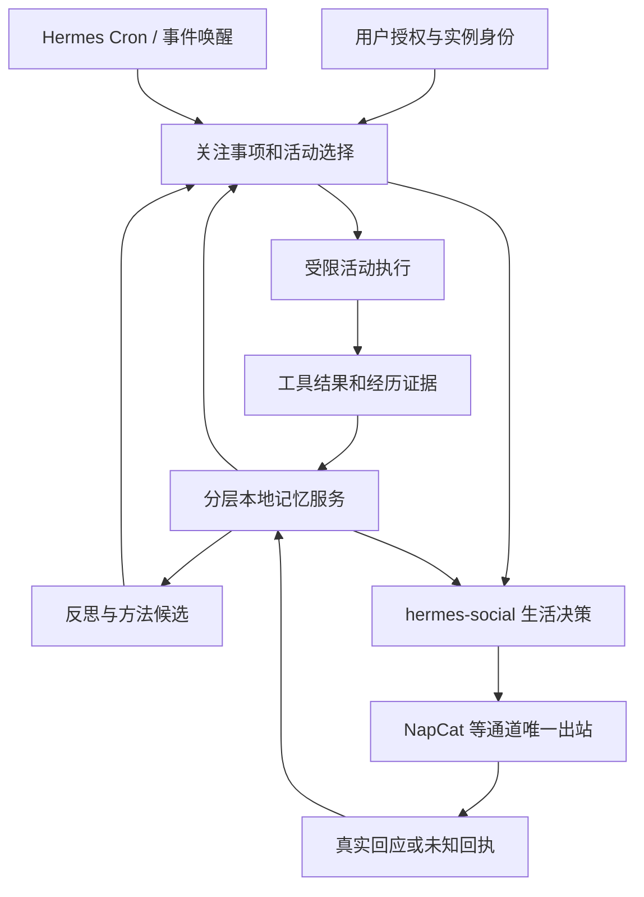
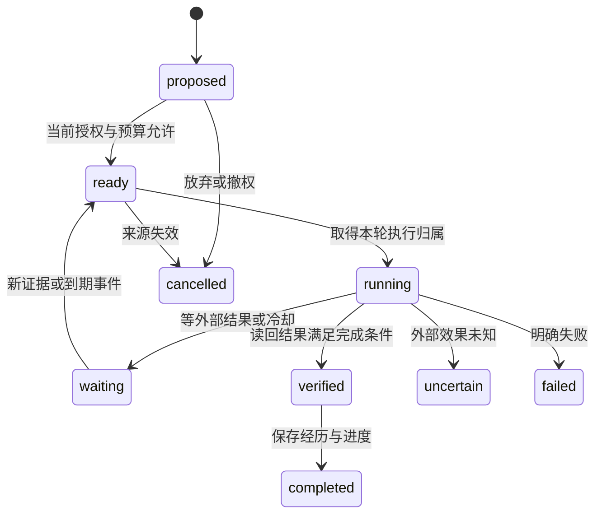

# 互联网生活能力开发方案

日期：2026-10-31。目标是让任意实例在授权范围内持续阅读、探索、创作、参与交流、积累经历，并让经历影响之后的选择。Hermes Companion 不预设角色身份、性格、兴趣或关系。初始自我描述属于实例；之后如何形成或修订认识，应由经历与反思来支撑。

本文描述完整目标。M1 首个源码切片提供显式自述、本人核对、同群召回与修订／忘记，见[实现记录](人物记忆首个切片.md)；后续已补规则候选和话题状态，真实接线仍待验收。后续生活能力不因写入规划而自动启用。论文、固定版本代码与采用取舍见[研究与代码参考](研究与代码参考.md)，当前安装条件见[本地 Hermes 能力核对](本地Hermes能力核对.md)。

后续 M1 源码已补[纯本地记忆与交流续接](纯本地记忆与交流续接.md)：公共接口、规则候选、对话／话题及本地派生撤回。M2 首个切片已接通[共同经历、明确约定与统一联系反馈](共同经历约定与联系反馈.md)，本地机会也无需模型 API。真实模型／QQ 验收、公开阅读／笔记和有来源的成果分享仍待继续，不将首个约定闭环称为 M2 全部完成。

本轮另完成[群聊参与与实例解耦修复](群聊参与与实例解耦修复.md)：移除固定角色和关键词意图门槛，提供同群临时上下文及真实交流证据；全合成模型验证为八项通过、一项误插话，后者仍待修复，不代表已部署或完成长期成长。

## 2026-10-31：根据论文与实际群聊调整实施重点

重新核对 [Generative Agents v2，第 4 节](https://arxiv.org/html/2304.03442v2)与 [Agentopia v1，第 3、4 节](https://arxiv.org/html/2606.07513v1)。前者把观察、检索、反思和计划接成行为循环；后者另有基于经验轨迹的模型训练。两者不能用“多保存聊天”或“增加触发关键词”代替。

当前实现的偏差是：记忆主要承载人物资料、交流原文和约定；反思及经验回用被推迟到 M4。近期接话修复又集中于局部措辞、候选合并和发送新鲜度。它们能改善接线，却不足以让经历改变后续选择。共享公开上下文、可靠回执与撤销机制保留为基础；移除关键词意图筛选和固定人格只是纠正基础架构，不计为完整认知闭环已交付。

## 运行层定位与自我模型

`hermes-social` 应定位为互联网生活运行层，社交只是一个活动适配器。当前保留插件 ID、配置命名空间和存储路径，避免名称迁移与行为变更混在一起；本轮尚未实现通用活动执行器。目标分工如下：

| 层 | 职责 | 可发展的内容 |
| --- | --- | --- |
| 互联网生活运行层 | 观察机会、检索经历、提出选项、选择行动或等待、核对结果并安排复盘 | 关注事项、计划、选择理由和已验证方法 |
| 活动能力 | 交流、阅读、探索、创作等具体行动；返回真实回执 | 能力使用经验；每种活动仍须明确接入 |
| life-memory | 保存自身经历、他人印象、反思、活动进度及自我修订 | 带来源和版本的数据，不是自动追加的系统指令 |
| scoped-memory | 本地检索、来源依赖、可见范围、修订与删除 | 支撑回用，不能因召回而改变权限 |
| 通道／宿主 | 验证真实来源、工具权限、收件人、预算与生命周期 | 只能由受信任配置改变的执行边界 |

固定内容仅保留任务协议、输出结构和真实执行边界。角色、语气、好恶、关系判断和行为经验不得写成框架常量，也不由呼唤名推定。`public_self` 是可选的初始公开资料，不读取私人 SOUL；它不是已经实现的自我发展机制。

下一切片应增加独立的本地自我模型版本：`instance_id`、`revision`、`description`、`interests`、`communication_preferences`、`evidence_refs`、`visibility`、`supersedes` 与状态。将初始自述、临时假设及验证过的经验分开；不把某个群友说“你就是……”直接提升为身份事实，也不把一次表扬永久固化为性格。

修订走“经历与结果→反思候选→小范围试用→后续证据→保留／修订／撤销”。模型可在已有预算的正常回合提出候选，存储层校验来源、实例和范围；公共场所只读取允许公开且依赖仍有效的部分。冲突、过期、撤回和反例应使修订重新评估，旧版本可追溯。框架不替实例预填人格，也不把经验当作允许任意修改权限或源码的指令。

验收不能只查提示词有没有变化：至少用两个不同初始身份运行同一框架；让一次有证据的失败形成方法候选，再在未写特判的新情境中观察选择变化；撤回来源后不再使用依赖该来源的结论；重启能恢复，其他实例、群及私人材料不串入。当前公共自述入口已实现，以上版本、反思与试用回路仍待开发。

下一切片必须同时具备以下闭环，不再等全部通信功能完成后才加入反思：

1. 在已授权场所记录有来源的观察、实际动作及结果，分清对方发言、已确认事实、自己的推断和角色故事。
2. 为一次有预算的决策提供当前公开情境、相关经历、自己的关注事项及未完成计划；由模型选择回应、等待、继续活动或暂不行动。路由只管理身份、场所、明确控制和资源边界，不用措辞列表推断人际意图。
3. 对有反馈或重要的经历形成带证据的反思候选，记录下次可尝试的做法；观察到回复不自动等于关系改善，沉默也不自动等于拒绝。
4. 在后续相似但未写入特判的情境中召回该经验，实际改变选择；保存效果与反例，允许修订和撤销。

人物事实的核对机制继续保留；自己的临时印象与行为经验单列，不能当成对方承认的事实或双向友谊。角色的稳定价值与逐步形成的兴趣、经历、表达习惯分层管理，不能用每轮自报“成长”替代后续行为证据。

`hermes-life-memory` 和 `scoped-memory` 的存储、检索、证据与删除继续使用本地实现。反思内容可由 Hermes 在正常决策或有预算的复盘回合中提出，记忆组件负责验证、持久化与召回，不增加独立的记忆服务 API。若要求语义推理也完全离线，则另需本地模型；零模型参与的存储组件本身不产生语义反思。

本项目先验证不改模型参数的经验适应。底层模型能力训练须有可训练模型、轨迹数据和独立评测，不能将调用固定模型并更新本地笔记称为权重学习。模拟世界的环境反馈也不能充当真实网页读取、真实社交互动或实际执行结果。

## 要形成怎样的能力

“独立生活”在这里对应可观察的软件行为：没有新聊天指令时，也能从已授权的兴趣和约定中选择有意义的活动；离线或重启后知道进行到了哪里；谈起昨天时能找到真实经历；与人交谈会记得对象、背景和边界；一次失败会改变后续做法。

至少支持六类能力：

| 能力 | 应出现的实际行为 | 证明方式 |
| --- | --- | --- |
| 连续经历 | 记得做过什么、何时做、结果如何 | 来源、活动 ID、时间和执行结果可读回 |
| 自主选择 | 在既定授权内选择阅读、创作、继续约定或休息 | 能说明选项、选择依据及放弃理由，不要求每一步重新提示 |
| 世界接触 | 阅读真实资料、观察变化、使用获准工具 | 浏览／工具回执和当前来源，不由模型生成“世界已经发生的结果” |
| 关系与社交 | 分清对象，延续共同话题，适时联系并接受拒绝 | 可信成员、关系事件、共享联系预算和真实反馈 |
| 积累与成长 | 修正认识，将验证过的方法用于新任务 | 修订记录和后续复用成绩；增加记忆条数不单独算成长 |
| 可恢复与可控制 | 停止、撤权、断网、重启后状态可解释 | 可见活动状态、预算、恢复记录与停止行为 |

项目以行为的连续、可追溯和改善为验收，不用台词自述或外观拟真作为充分证据。角色故事仍作为故事；真实交往、模拟经历、未来计划和模型推断分别保存。

## 从现有能力起步

仓库已经有 QQ 事件／工具／发送边界、social 的近期上下文与参与控制、scoped-memory 的证据／删除／候选与检索组件。上一轮四项修复已提交，完整人物模型与 social 的长期记忆连接尚未交付。

前次核对时，default 使用 Mem0，social 安装版为 `0.1.0`，scoped-memory 目录只有供公共执行使用的 worker；完整历史快照见[核对记录](本地Hermes能力核对.md)。这些记录不能代替当前安装、配置及进程加载状态，实际修改前须重新核对。

Hermes 已提供 Cron、单会话 goal、heartbeat、loops、Skills、插件与工具执行。生活层增加关注事项、活动进度、经历和选择规则；持久唤醒及一次任务的执行尽量复用已有设施。尤其当前 cron 会加载本 home 的 SOUL 与记忆，不能把私人 default 直接作为面向公共场所的生活执行域。

## 组件职责

以下列出完整目标职责；生活组件与通用端口仍属提案，life-memory 已有的子集以各阶段实现记录为准，不将提案接口冒充 SDK 能力。

| 组件 | 职责 | 不能代替的职责 |
| --- | --- | --- |
| 通道 | 认证真实事件、准入、目标、消息／附件和出站回执 | 不定义角色人生、人物事实或兴趣 |
| `hermes-social` | 当前实现交流与联系；目标统一管理关注、计划、活动选择、结果与复盘 | 不直接拼接私人库，不成为第二个发送者，不把未来执行器称为已实现 |
| 独立分层本地记忆插件（暂名 `hermes-life-memory`） | 自身经历、人物资料、事件、反思、出处、修订与撤回 | 不自行扩大可见范围或取得对方确认权 |
| 生活组件（暂名 `hermes-life`） | 兴趣／约定、选择活动、进度、结果判断与复盘 | 不另建通用 scheduler，不管理账号密钥，不绕过工具授权 |
| Hermes 宿主 | 调度、Agent 回合、模型／工具调用、会话、插件生命周期 | 单独存在不保证人物记忆隔离或生活连续 |
| Skills | 保存已验证的可复用方法 | Skill 文本不授予新增权限，不把生成代码立即变成常驻能力 |

先定义服务端口并复用 scoped-memory 的存储、证据、事务、删除清单和检索模块；不复制第二套相似数据库。独立记忆插件先提供服务能力，不抢占私人 default 的 `memory.provider=mem0`。若以后需要 MemoryProvider facade，只在专属 home 显式选择一个 provider，不在同一 home 同时启用两个外部 provider。

## 先完成社交与人物记忆

### 对话状态

在已有真实 reply-to 基础上，保存当前话题、回应对象、参与者、待回答问题、共同约定、最近一次主动发起及反馈。区分倾诉、分享、提问、短答与结束信号；主题状态只作为判断资料，不能授予发送权限。

主动联系用“机会”表示，携带目标场所、相关参与者、理由、来源、有效期和预算类别。所有活动共用 social 的联系账本，发起分享、延后关心或履行约定不能各自另算额度。无人回应、明确拒绝与已经回复分开记录；不从无人回应推断对方人格或确定关系。

### 人物不是贡献者的别名

现有 Store 按贡献者与来源隔离。未来需要另外区分：

- `memory_owner`：哪一个生活实例维护这条记录。
- `subject_id`：资料说的是谁；使用经过验证的平台成员 ID，显示名只作别名。
- `asserted_by`：谁作出陈述；第三人转述不能变成本人已确认资料。
- `source_refs`：消息／网页／执行结果的 ID、修订与哈希。
- `visibility`：在哪个场所、供谁、为哪种用途可读。
- `valid_from / valid_until`、状态、冲突和修订关系。

这些字段必须进入存储和访问合同。不能将现有 `owner` 统一改成机器人 ID，借此读取所有成员的旧记录；旧数据只在证据和授权能重新解释时迁移。

### 记忆的七个视图

| 视图 | 内容 | 生效与更新规则 |
| --- | --- | --- |
| 当前工作记忆 | 当前活动、话题、未完成步骤 | 小预算、短生命周期，来自当前有效状态 |
| 自身情景经历 | 读到的资料、做过的创作、一次交谈及结果 | 关联真实回执；记录失败与未完成，不能只保留成功 |
| 人物与互动偏好 | 自述、称呼偏好、兴趣、联系边界 | 证据候选与本人核对；第三人说法、模型假设分别标记 |
| 事件与约定 | 共同讨论、计划、承诺及进展 | 有时间、参与者、状态和过期条件，不能把计划记成完成 |
| 世界知识 | 从公开资料得到的带来源认识 | 记录发布者主张、读取时间及修订，网页出现不等于主张已证实 |
| 反思与方法 | 从经历形成的认识、下一次做法、可复用 Skill 候选 | 依赖原证据，可反驳／撤销；方法经后续复用验证才升级 |
| 自我与关注事项 | 获准身份、价值取舍、当前兴趣和长期项目 | 核心身份由受信配置管理；兴趣可随经历修订，不能自动改写 SOUL 或授权 |

这是独立本地服务的逻辑视图，不要求七个数据库。模型可以提议更新，服务核验来源、状态和权限。人物事实按既有核对流程处理；自身一次工具执行是否发生，由回执确认，不要求用户逐条确认。

## 同一个实例，不同的可见场所

生活实例具有稳定的实例 ID，但实例 ID、对话者身份和当前输出场所是三个独立维度。私人对话、公共群、公开网页和本地创作可在同一身份叙事中持续存在，读取仍由用途与来源决定。

群 idle 没有当前成员主体，只能读取该群批准的公共事实及可分享的自身公开活动。私聊得知的偏好、私人共同经历和未发布作品，不能因同一账号出现在群中就被读取。自己读过的公开文章可以形成分享候选，但候选若依赖私人讨论，也必须遵守这部分依赖的可见范围。

本地生活记忆不自动进入 Mem0，不导入整个 default 历史，也不将私人 SOUL 复制到公开 worker。公开表达只使用明确公开的自我资料与可见经历；私人关系资料保留原场所。

## 生活循环与真实活动

### 关注事项产生有终点的活动

关注事项可以来自用户明确委托、既有约定、获准兴趣，或基于近期经历提出的新兴趣。保存来源、形成理由和修订过程，不能把用户愿景写成角色早已自主产生的愿望。

每次决策先处理真实用户消息、需要履行的约定和在途任务，再比较探索价值、所需资源、信息新鲜度和是否适合当前场所。无变化、预算不足或没有有意义选项时，可以等待。拟人的饥饿、好感分或“必须每天发言”不作为驱动正确性的前提。

活动必须有输入、范围、下一步、完成证据和停止条件。选择只读论文阅读、整理一篇笔记、完成一幅获准创作，均能在单次预算内结束；“永远更像一个真人”不能直接成为无限 `/goal`。

### 活动状态与结果

活动记录至少包含 `activity_id`、实例与 profile 绑定、授权版本、来源／任务、截止期、状态、执行租约、进度、产物引用、费用／资源使用及结果证据。真实时间使用 UTC 存储、时区显示；模拟环境另记 `simulation_id` 与模拟时间，不能混入真实“昨天”。

模型提出“已完成”后，由执行器核对文档、工具返回或指定断言。无法读取页面时记录失败，不声称已经阅读；生成作品和实际发布是不同结果。外部发送效果未知时标记 uncertain，先读回或等待，不自动再次发送；接口没有幂等保证时不承诺 exactly once。

### 执行、唤醒与记忆如何接线

1. 确定性地接收事件、检查到期活动及变化摘要；没有变化就不调用模型。
2. 需要选择时读取最小授权记忆，生成活动提案。既有持续授权覆盖的阅读和本地写入可直接推进，不为每个步骤重新询问。
3. 专属受限执行域接收活动与能力票据。Cron 可唤醒，goal 可承载一个有验收条件的子任务；heartbeat／loops 只用于相应会话或限期观察，不多处重复唤醒同一活动。
4. 保存结果证据与活动状态；按来源形成自身经历、人物候选、约定进展或方法候选。
5. 确有交流价值时把分享机会交给 social，再经原通道复核与发送；活动执行器不直接获取任意发送能力。
6. 定期或重要事件后复盘，调整关注事项和后续计划；反思保留证据依赖，不变成新的事实来源。

权限票据、活动 API 和记忆服务端口是后续待实现合同。活动不得自行增加账号、扩大场所、安装插件或改变核心身份。需要扩大这些范围时提交具体变更；在已经批准的范围内自主选择与执行。

## 生命周期与资源约束

复用 Hermes 的 occurrence、租约及进程管理，但活动本身要有持久进度。插件卸载、身份／策略变化、撤回和忘记须撤销在途许可；重启后先检查活动状态与外部效果，再决定是否继续。只有读操作和明确幂等操作可以按规则自动重试。

设置日总预算、单活动预算、并发与请求上限、检索／反思预算、网络失败退避和人工暂停入口。价格未知或 usage 缺失不能记成零费用；记录 token／请求数和实际可得费用。纯状态维护、去重和无变化判断不消耗模型调用，不采用游戏高频 tick 持续推理。

工作记忆在回合边界按宿主合同注入或以工具结果追加，不在既有会话中热改 system 前缀或工具集。来源撤回后同时处理缓存、派生反思和计划；已经进入旧上下文的内容不能声称被“抹掉”，必要时使该上下文失效并重建，延续现有删除 epoch 的思路。

反思不能升级权限、确权人物事实或把计划改为已完成。经验学习先体现为检索策略、活动选择和可验证 Skill 的改善；权重训练、Agentopia 生活奖励训练与自行修改核心代码均留在独立研究阶段。

## 接口开发顺序

| 提案端口 | 输入 | 返回与约束 |
| --- | --- | --- |
| 可信事件接收 | 通道签发的实时身份／场所、消息／工具回执 | 可追溯事件；文本中的 ID 不取得授权 |
| `MemoryPort.recall` | 受信 scope、用途、话题／人物引用和预算 | 读取前过滤的最小资料、出处、状态与可见性；不接受模型任意 owner 参数 |
| `MemoryPort.propose / review / decide` | 当前本人来源与候选证据 | 按已有核对命令原则处理；模型只能提议 |
| `ActivityPort.submit / advance` | 已授权活动与当前执行归属 | 下一状态、产物／错误与真实回执 |
| `SocialOpportunityPort.offer` | 获准场所、可见来源、联系理由与有效期 | 接受、延后或放弃；发送仍由通道负责 |
| 撤回／失效通知 | 来源修订、删除 epoch、策略版本与依赖 ID | 撤销派生缓存、计划和机会；缺通知时发送／注入前再次复核 |

这些端口是完整目标合同，尚非现成 SDK API。首个切片通过现有 `register_platform_handler` 与新增通道 `social_memory_contract = 1` 接线，暂不增加通用服务注册表；后续扩展以实际 Store 和精确来源许可验证。

## 分阶段交付与验收

| 阶段 | 交付内容 | 进入下一阶段的条件 |
| --- | --- | --- |
| M0 匹配基线 | 锁定宿主本地差异、插件、worker、安装前提和临时 home 复验 | 四项修复可重现；明确哪条路径有记忆，哪条只是 prepare |
| M1 社交与人物记忆 | 对话状态、独立本地人物服务、自述核对、同群召回与忘记 | 同名不合并；转述不确权；跨人／群／私聊与 idle 无主体均按策略处理；撤回竞争不恢复旧资料 |
| M2 最小社交认知闭环 | 情景／约定、相关经历召回、模型决策、实际反馈、带证据反思及下一次回用 | 对照相似新情境证明经验改变行为；明确未知与误判；统一额度，未知回执不重发 |
| M3 一种真实互联网生活活动 | 阅读公开白名单资料→笔记→经历→下一次续读 | 无新聊天也能推进；重启可恢复；失败不伪造完成；能准确回答何时读过什么 |
| M4 长期学习评估 | 扩展 M2 已接通的反思回用，验证兴趣修订、方法迁移和角色连续性 | 跨会话、跨天及新任务有对照；保留反证，不自动修改核心身份和权限 |
| M5 扩展世界与表达 | 第二类活动、社区／设备适配、可选语音／视觉表达 | 独立验收新的工具、场所、出站和资源预算；LPM 等仅作表达研究参考 |

M1、M2 是当前先完成的工作。它们的数据合同同时容纳自己的活动经历和他人资料，为 M3 留出接口，不将 social 扩写成整个人生运行时。统一安装器、人格市场、多人小镇、模型训练和视频化不抢占这条主线。

## 怎样判断更真实，而不是只更会说

采用版本化合成事件与授权测试数据，记录下列结果，不以发言次数、聊天时长、点赞或模型自评好感为总奖励：

- **经历准确性**：叙述与实际读取／执行／发送回执一致；不存在的活动能够回答“未发生／不知道”。
- **连续性**：重启、压缩、换会话后能继续同一活动，正确解释未完成和过期事项。
- **人物与时间**：自述、转述、修订与过期资料分开；时间问题和无法回答问题单列。
- **社交合适度**：人工评审接话对象、时机、内容关联、拒绝和退让；统计不必要打扰。
- **学习效果**：后续同类活动是否更可靠、少走弯路，代价是否降低；反思可被反证和撤销。
- **边界与成本**：在测试样本中不得越权、复活已忘记资料或重复发送；报告无变化时的调用量、延迟和预算使用。

参照 LongMemEval 做分类评估，权限、删除、竞争和幂等用确定性断言，交流自然度由人工场景评审。不能只让同一个模型出题、执行、打分后宣称生活能力成立。

首个完整示例可以是：一个实例从自己的关注事项选择并阅读一篇获准公开文章，留下来源和笔记；几天后继续这个主题，恰好与原群话题相关时提出分享；对方修正看法后保留修订；无人回应时继续自己的活动。这是后续验收场景，本轮没有启动该活动。
